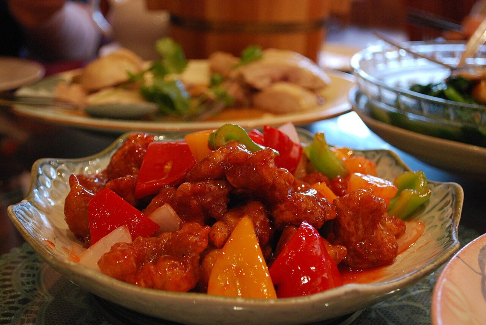

# Sweet and sour sauce

*Photo: [Alpha from Melbourne, Australia](https://commons.wikimedia.org/wiki/File:Flickr_-_Sweet_and_Sour_Pork.jpg), [CC BY-SA 2.0](https://creativecommons.org/licenses/by-sa/2.0/), via Wikimedia Commons.*

Vinegar, sugar, tomato and pineapple juice thickened with cornstarch: the Cantonese sauce for sweet and sour pork (gu lou yuk), fried chicken and egg rolls.

🥄 Serves **4** · ⏱️ 10 minutes · Difficulty: easy

*En español:* [Salsa agridulce](agridulce.es.md)

## Ingredients

- ½ cup pineapple juice
- ¼ cup rice vinegar (or cider vinegar)
- ¼ cup packed brown sugar
- 3 tablespoons ketchup
- 1 tablespoon soy sauce
- 1 tablespoon cornstarch mixed with 3 tablespoons water
- A few pieces of pineapple, red bell pepper and onion (optional)

## Directions

1. **Base.** Put the pineapple juice, vinegar, sugar, ketchup and soy sauce in a saucepan.
2. **Boil.** Heat over medium heat, stirring, until the sugar dissolves and it starts to boil.
3. **Thicken.** Add the cornstarch slurry and stir for 1 minute, until glossy and thick.
4. **Vegetables.** If using, stir-fry the pineapple, pepper and onion in a wok for 2 minutes first, then pour the sauce over them.
5. **Serve.** Toss with the fried pork or chicken just before serving so it stays crisp.

## Tips

- **Balance:** taste and adjust with more vinegar or sugar; it should not be cloying.
- **Natural color:** ketchup is enough; no food coloring needed.
- **As a dip:** serve it on the side with egg rolls or fried wontons.
