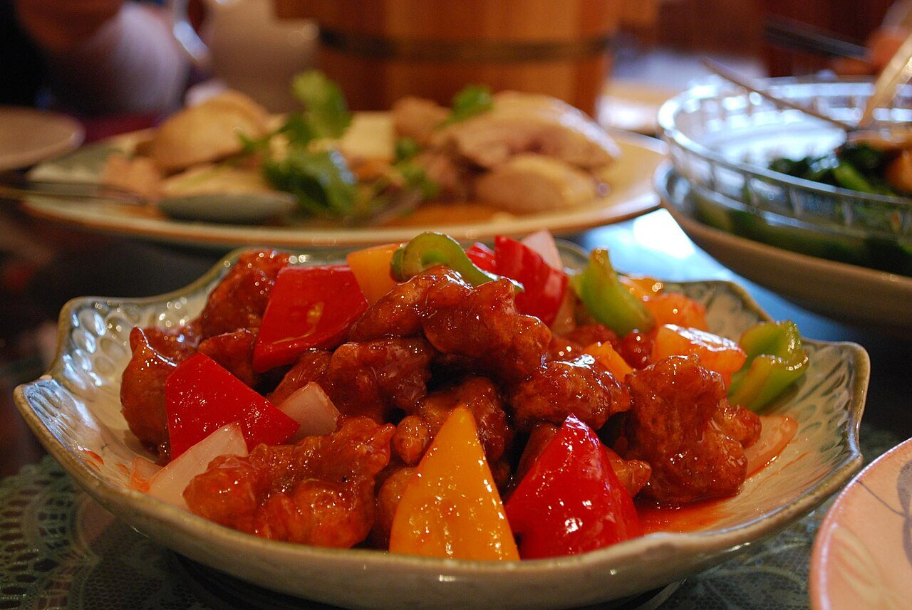

# Salsa agridulce

*Foto: [Alpha from Melbourne, Australia](https://commons.wikimedia.org/wiki/File:Flickr_-_Sweet_and_Sour_Pork.jpg), [CC BY-SA 2.0](https://creativecommons.org/licenses/by-sa/2.0/deed.es), vía Wikimedia Commons.*

Vinagre, azúcar, tomate y zumo de piña espesados con maicena: la salsa cantonesa del cerdo agridulce (gu lou yuk), el pollo rebozado y los rollitos.

🥄 Para **4 personas** · ⏱️ 10 minutos · Dificultad: fácil

*In English:* [Sweet and sour sauce](agridulce.en.md)

## Ingredientes

- 120 ml de zumo de piña
- 60 ml de vinagre de arroz (o de manzana)
- 50 g de azúcar moreno
- 3 cucharadas de kétchup
- 1 cucharada de salsa de soja
- 1 cucharada de maicena disuelta en 3 cucharadas de agua
- Unos trozos de piña, pimiento rojo y cebolla (opcional)

## Preparación

1. **La base.** Pon en un cazo el zumo de piña, el vinagre, el azúcar, el kétchup y la soja.
2. **Hervir.** Calienta a fuego medio, removiendo, hasta que el azúcar se disuelva y empiece a hervir.
3. **Espesar.** Añade la maicena disuelta y remueve 1 minuto, hasta que la salsa quede brillante y espesa.
4. **Las verduras.** Si las usas, saltea antes la piña, el pimiento y la cebolla 2 minutos en el wok y añade la salsa por encima.
5. **Servir.** Mézclala con la carne o el pollo rebozados justo antes de servir, para que sigan crujientes.

## Consejos

- **Equilibrio:** prueba y ajusta con más vinagre o más azúcar; no debe empalagar.
- **Color natural:** el kétchup basta; no hace falta colorante.
- **Para mojar:** sírvela aparte con rollitos de primavera o wontons fritos.
