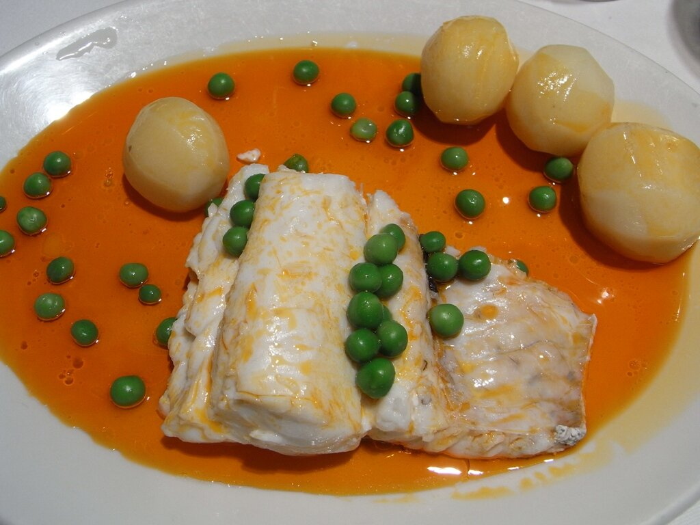

# Galician garlic and paprika oil

*Photo: [Javier Lastras](https://commons.wikimedia.org/wiki/File:Pescada_%C3%A1_galega.jpg), [CC BY 2.0](https://creativecommons.org/licenses/by/2.0/), via Wikimedia Commons.*

Olive oil fried with garlic and Spanish paprika: the classic sauce for Galician-style hake and octopus.

🥄 Serves **4** · ⏱️ 10 minutes · Difficulty: easy

*En español:* [Ajada gallega](ajada.es.md)

## Ingredients

- Scant ½ cup olive oil
- 4 garlic cloves
- 1 teaspoon sweet smoked Spanish paprika (or half sweet, half hot)
- 1 tablespoon white wine vinegar (optional)
- Salt

## Directions

1. **Garlic.** Peel the garlic and slice it thin.
2. **Fry.** Heat the oil over medium heat and slowly fry the garlic until golden, without burning it.
3. **Paprika.** Take the pan off the heat, wait about 30 seconds and stir in the paprika. If the oil is too hot, the paprika burns and turns bitter.
4. **Finish.** Add the vinegar, if using, and a pinch of salt. Pour it hot over the fish right away.

## Tips

- **Classic pairing:** poached hake with boiled potatoes and peas.
- **Also great** over octopus or steamed cauliflower.
- **Mind the paprika:** always add it off the heat.
