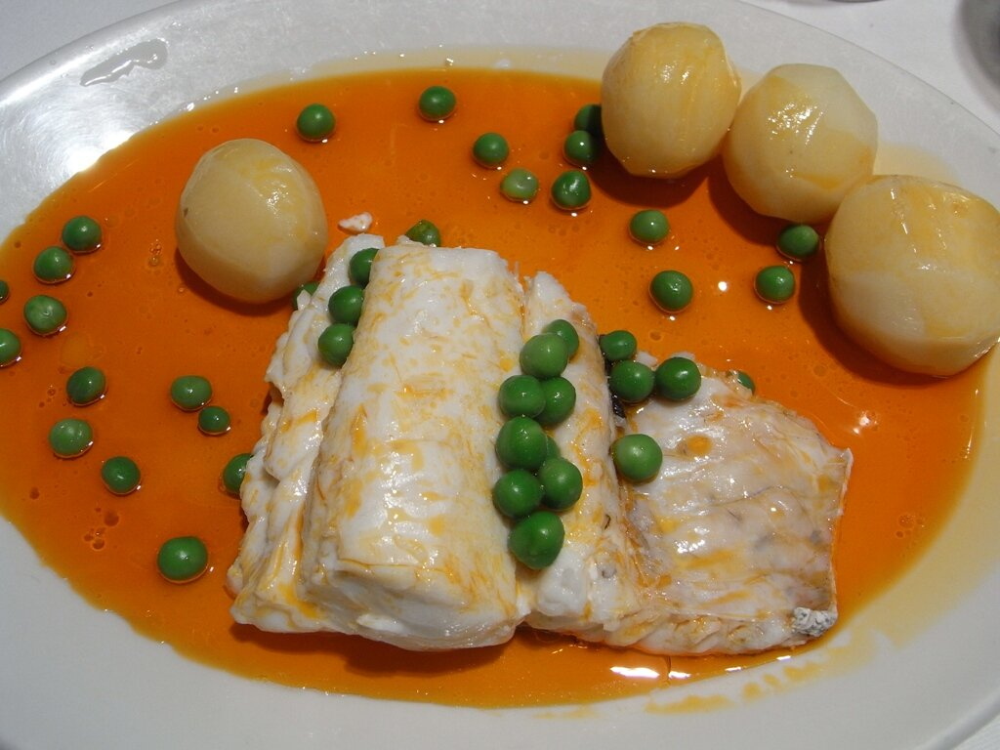

# Ajada gallega

*Foto: [Javier Lastras](https://commons.wikimedia.org/wiki/File:Pescada_%C3%A1_galega.jpg), [CC BY 2.0](https://creativecommons.org/licenses/by/2.0/deed.es), vía Wikimedia Commons.*

Aceite frito con ajo y pimentón: la salsa de la merluza y el pulpo «á galega».

🥄 Para **4 personas** · ⏱️ 10 minutos · Dificultad: fácil

*In English:* [Galician garlic and paprika oil](ajada.en.md)

## Ingredientes

- 100 ml de aceite de oliva
- 4 dientes de ajo
- 1 cucharadita de pimentón dulce (o mitad dulce y mitad picante)
- 1 cucharada de vinagre de vino blanco (opcional)
- Sal

## Preparación

1. **Los ajos.** Pela los ajos y córtalos en láminas finas.
2. **Dorar.** Calienta el aceite a fuego medio y dora los ajos despacio, sin que se quemen.
3. **El pimentón.** Aparta la sartén del fuego, espera unos 30 segundos y añade el pimentón removiendo. Si el aceite está demasiado caliente, el pimentón se quema y amarga.
4. **Terminar.** Añade el vinagre, si lo usas, y una pizca de sal. Sirve enseguida, caliente, sobre el pescado.

## Consejos

- **Clásico:** merluza cocida con patatas y guisantes, regada con la ajada.
- **Con pulpo o con coliflor** también es tradicional.
- **Vigila el pimentón:** fuera del fuego, siempre.
