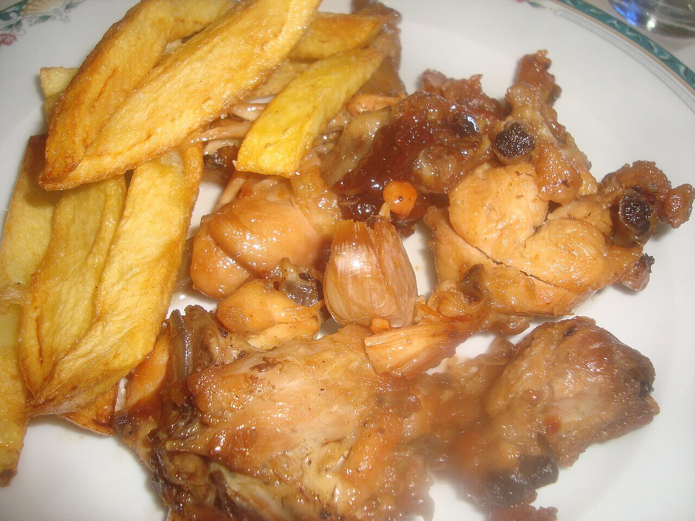

# Spanish garlic and white wine sauce

*Photo: [Juan Emilio Prades Bel](https://commons.wikimedia.org/wiki/File:Pollo_al_ajillo.jpg), [CC BY-SA 4.0](https://creativecommons.org/licenses/by-sa/4.0/), via Wikimedia Commons.*

Garlic, white wine, bay leaf and chile: the sauce for Spanish garlic chicken or rabbit.

🥄 Serves **4** · ⏱️ 45 minutes · Difficulty: easy

*En español:* [Salsa al ajillo](ajillo.es.md)

## Ingredients

- 1 chicken or rabbit, cut up (about 2½ lb)
- 1 head garlic
- ⅔ cup dry white wine
- Scant ½ cup chicken stock
- 2 bay leaves
- 1 small dried chile (optional)
- 1 tablespoon chopped parsley
- 6 tablespoons olive oil
- Salt and pepper

## Directions

1. **Brown the meat.** Season the meat and brown it well on all sides in the oil over medium heat. Set aside.
2. **Garlic.** In the same oil, over low heat, fry the whole, lightly crushed, unpeeled garlic cloves with the bay leaves and chile.
3. **Wine.** Return the meat, raise the heat and pour in the wine. Let the alcohol cook off for 2–3 minutes.
4. **Braise.** Add the stock, cover and simmer 25–30 minutes, turning the meat now and then, until the sauce reduces.
5. **Finish.** Uncover for the last few minutes so the sauce thickens, and sprinkle with parsley.

## Tips

- **Unpeeled garlic** burns less and turns creamy inside.
- **Serve with** fries or bread for the sauce.
- **For more depth,** swap half the white wine for a splash of fino or manzanilla sherry.
