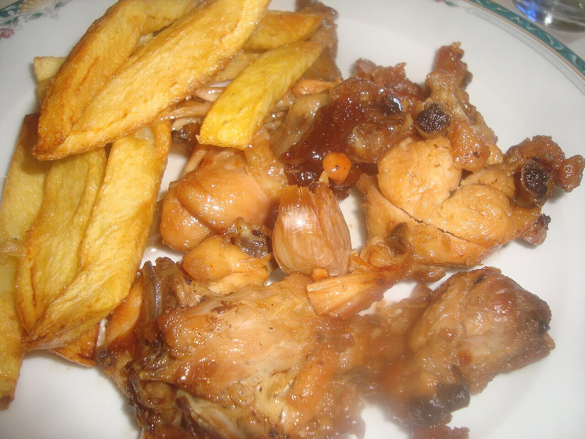

# Salsa al ajillo

*Foto: [Juan Emilio Prades Bel](https://commons.wikimedia.org/wiki/File:Pollo_al_ajillo.jpg), [CC BY-SA 4.0](https://creativecommons.org/licenses/by-sa/4.0/deed.es), vía Wikimedia Commons.*

Ajo, vino blanco, laurel y guindilla: la salsa del pollo y el conejo al ajillo.

🥄 Para **4 personas** · ⏱️ 45 minutos · Dificultad: fácil

*In English:* [Spanish garlic and white wine sauce](ajillo.en.md)

## Ingredientes

- 1 pollo o 1 conejo troceado (unos 1,2 kg)
- 1 cabeza de ajos
- 150 ml de vino blanco seco
- 100 ml de caldo de pollo
- 2 hojas de laurel
- 1 guindilla (opcional)
- 1 cucharada de perejil picado
- 6 cucharadas de aceite de oliva
- Sal y pimienta

## Preparación

1. **Dorar la carne.** Salpimienta la carne y dórala bien por todos lados en el aceite, a fuego medio. Retírala.
2. **Los ajos.** En el mismo aceite, a fuego suave, dora los dientes de ajo enteros y chafados, con su piel, junto con el laurel y la guindilla.
3. **El vino.** Vuelve a meter la carne, sube el fuego y moja con el vino. Deja que se evapore el alcohol 2–3 minutos.
4. **Guisar.** Añade el caldo, tapa y cuece a fuego suave 25–30 minutos, dando la vuelta a la carne de vez en cuando, hasta que la salsa reduzca.
5. **Terminar.** Destapa los últimos minutos para que la salsa espese y espolvorea el perejil.

## Consejos

- **Los ajos con piel** se queman menos y quedan cremosos por dentro.
- **Con** patatas fritas o pan para la salsa.
- **Más intensa:** cambia la mitad del vino blanco por un chorro de fino o de manzanilla.
