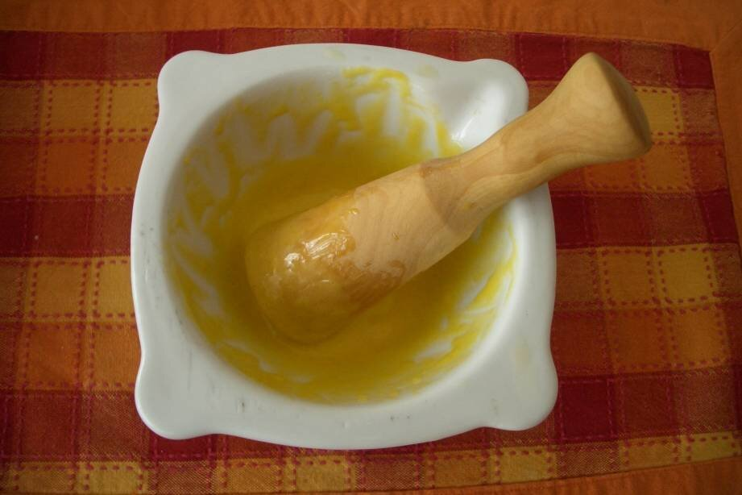

# Garlic and olive oil emulsion

*Photo: [Ralph Sperling](https://commons.wikimedia.org/wiki/File:Allioli.jpg), public domain, via Wikimedia Commons.*

Garlic and oil emulsified by hand in a mortar, with no egg, the way it's done in Catalonia, Valencia and the Balearic Islands.

🥄 Serves **4–6** · ⏱️ 20 minutes · Difficulty: medium

*En español:* [Alioli (allioli)](alioli.es.md)

## Ingredients

- 4 garlic cloves
- 1 pinch coarse salt
- ¾ cup plus 1 tablespoon mild olive oil
- A few drops lemon juice (optional)

## Directions

1. **Crush.** Peel the garlic, remove the green germ and pound it with the salt in a mortar into a smooth paste.
2. **Emulsify.** Add the oil drop by drop, stirring in circles, always in the same direction.
3. **Build it up.** Once the sauce starts to thicken, pour the oil in a very thin stream. It takes about 15 minutes.
4. **Adjust.** Add a few drops of lemon at the end if you like. It should be thick and glossy.

## Tips

- **Quick version with egg:** 1 egg, 2 garlic cloves, salt and the same oil in an immersion blender; keep the blade at the bottom until it emulsifies.
- **If it breaks:** start again in a clean mortar with one crushed garlic clove and slowly beat in the broken sauce.
- **Serve with** rice dishes, fideuà, potatoes, and grilled meat or fish.
