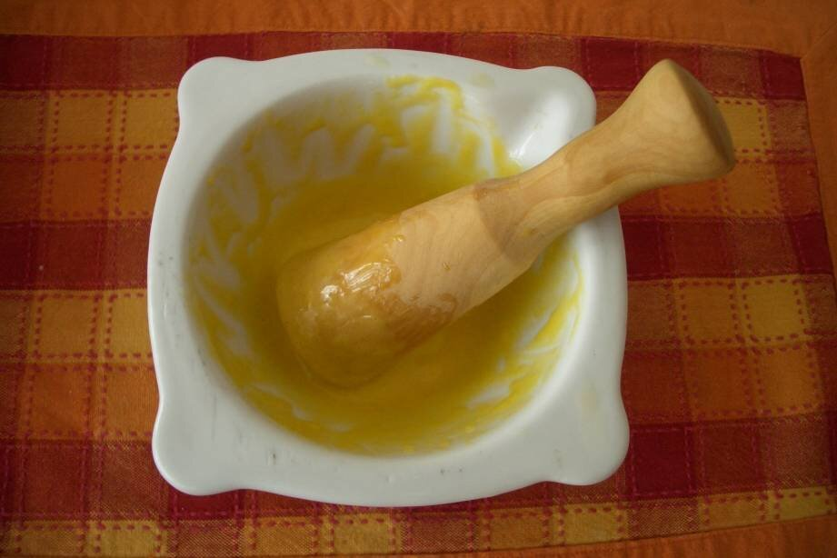

# Alioli (allioli)

*Foto: [Ralph Sperling](https://commons.wikimedia.org/wiki/File:Allioli.jpg), dominio público, vía Wikimedia Commons.*

Ajo y aceite ligados a mano en el mortero, sin huevo, como en Cataluña, Valencia y Baleares.

🥄 Para **4–6 personas** · ⏱️ 20 minutos · Dificultad: media

*In English:* [Garlic and olive oil emulsion](alioli.en.md)

## Ingredientes

- 4 dientes de ajo
- 1 pizca de sal gruesa
- 200 ml de aceite de oliva suave
- Unas gotas de zumo de limón (opcional)

## Preparación

1. **Machacar.** Pela los ajos, quítales el germen y machácalos en el mortero con la sal hasta tener una pasta fina.
2. **Ligar.** Añade el aceite gota a gota sin dejar de remover en círculos y siempre en el mismo sentido.
3. **Ir subiendo.** Cuando la salsa empiece a espesar, echa el aceite en un hilo muy fino. Tarda unos 15 minutos.
4. **Ajustar.** Si quieres, añade unas gotas de limón al final. Debe quedar espesa y brillante.

## Consejos

- **Versión rápida con huevo:** 1 huevo, 2 ajos, sal y 200 ml de aceite, con la batidora de brazo sin moverla hasta que emulsione.
- **Si se corta:** empieza en otro mortero con un ajo machacado y ve añadiendo la salsa cortada poco a poco.
- **Para acompañar:** arroces, fideuà, patatas, carnes y pescados a la brasa.
