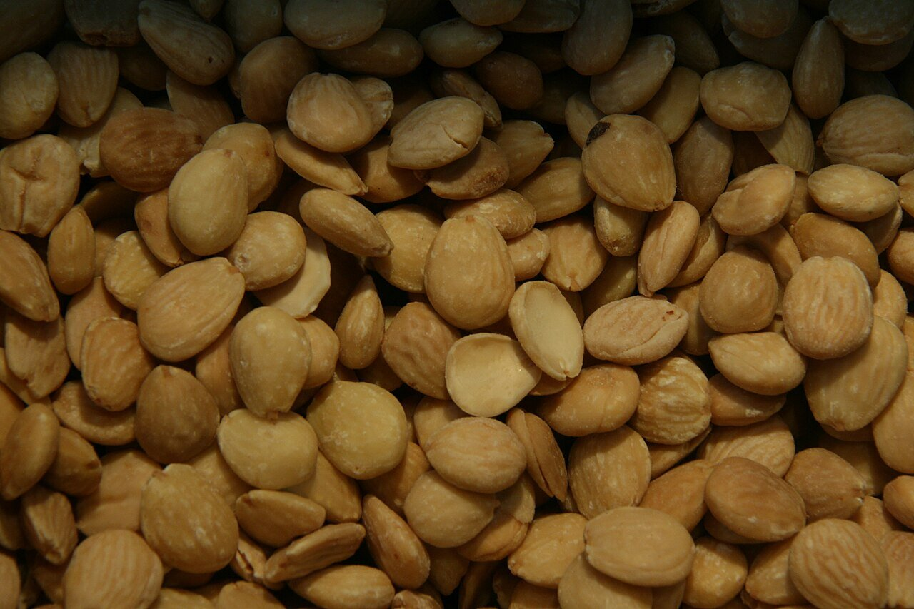

# Spanish almond sauce

*Photo: [Tamorlan](https://commons.wikimedia.org/wiki/File:Almendra_marcona.jpg), [CC BY 3.0](https://creativecommons.org/licenses/by/3.0/), via Wikimedia Commons.*

Fried almonds, garlic and bread, pounded and simmered in vegetable stock with saffron: a vegan sauce with no alcohol and no peppers. The photo shows the almonds, not the dish.

🥄 Serves **4** · ⏱️ 25 minutes · Difficulty: easy

*En español:* [Salsa de almendras](almendras.es.md)

## Ingredients

- ½ cup blanched raw almonds
- 2 garlic cloves
- 1 slice day-old bread
- 1⅔ cups vegetable stock
- A few saffron threads
- 1 tablespoon chopped parsley
- 4 tablespoons olive oil
- Salt

## Directions

1. **Fry.** In the oil over medium heat, fry the almonds, peeled garlic and bread separately until golden. Remove them and keep the oil.
2. **Pound.** Pound in a mortar (or blend) the almonds, garlic, bread, saffron and parsley with a little stock into a paste.
3. **Simmer.** In the same pot with its oil, add the paste and the rest of the stock. Simmer 10 minutes, stirring, until thickened.
4. **Adjust.** Season with salt. For a smoother sauce, blend again and strain.

## Tips

- **Serve with** vegan meatballs, chickpeas, potatoes, cauliflower or mushrooms.
- **Thinner:** add more stock; thicker, a little more bread.
- **Gluten-free:** replace the bread with more almonds.
