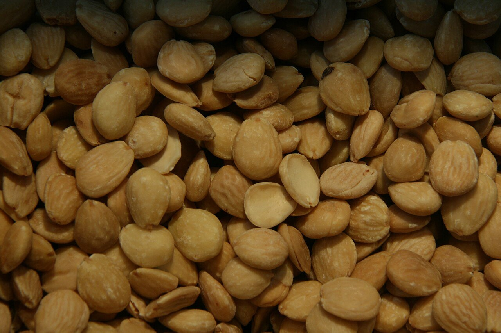

# Salsa de almendras

*Foto: [Tamorlan](https://commons.wikimedia.org/wiki/File:Almendra_marcona.jpg), [CC BY 3.0](https://creativecommons.org/licenses/by/3.0/deed.es), vía Wikimedia Commons.*

Almendras, ajo y pan fritos, majados y cocidos en caldo de verduras con azafrán: una salsa vegana, sin alcohol y sin pimiento. La foto muestra las almendras, no el plato.

🥄 Para **4 personas** · ⏱️ 25 minutos · Dificultad: fácil

*In English:* [Spanish almond sauce](almendras.en.md)

## Ingredientes

- 80 g de almendras crudas peladas
- 2 dientes de ajo
- 1 rebanada de pan del día anterior
- 400 ml de caldo de verduras
- Unas hebras de azafrán
- 1 cucharada de perejil picado
- 4 cucharadas de aceite de oliva
- Sal

## Preparación

1. **Freír.** En el aceite, a fuego medio, fríe por separado las almendras, los ajos pelados y el pan, hasta que estén dorados. Retíralos y guarda el aceite.
2. **Majar.** Machaca en el mortero (o tritura) las almendras, los ajos, el pan, el azafrán y el perejil con un poco de caldo, hasta tener una pasta.
3. **Cocer.** En la misma cazuela con su aceite, añade la pasta y el resto del caldo. Cuece a fuego suave 10 minutos, removiendo, hasta que espese.
4. **Ajustar.** Prueba de sal. Si la quieres más fina, tritúrala otra vez y cuélala.

## Consejos

- **Con** albóndigas veganas, garbanzos, patatas, coliflor o setas.
- **Más ligera:** añade más caldo; más espesa, un poco más de pan.
- **Sin gluten:** sustituye el pan por más almendras.
