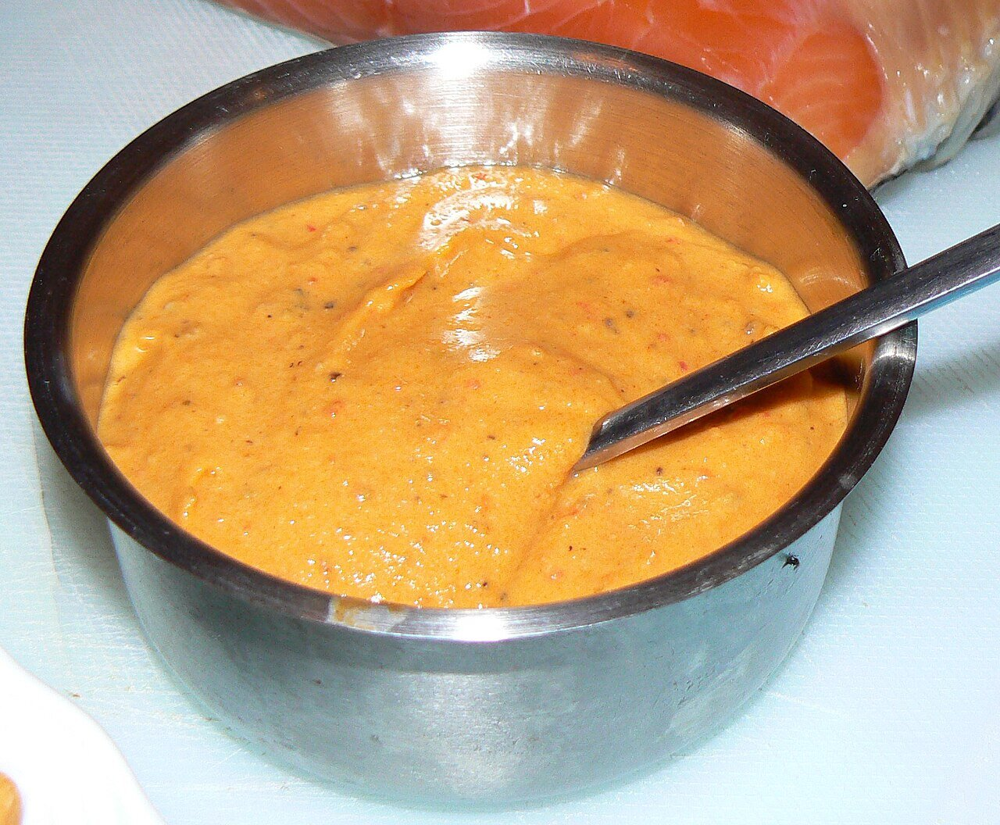

# La Gomera aged cheese spread

*Photo: [Flickr user sao mai](https://commons.wikimedia.org/wiki/File:Almogrote2.jpg), [CC BY-SA 2.0](https://creativecommons.org/licenses/by-sa/2.0/), via Wikimedia Commons.*

A spread of aged cheese, garlic, dried pepper and olive oil from the island of La Gomera.

🥄 Serves **6** · ⏱️ 15 minutes · Difficulty: easy

*En español:* [Almogrote gomero](almogrote.es.md)

## Ingredients

- 9 oz aged hard goat cheese
- 3 garlic cloves
- 1–2 dried Canarian peppers (or 1 small dried chile plus 1 teaspoon paprika)
- 1 small ripe tomato, peeled (optional)
- Scant ½ cup olive oil

## Directions

1. **Pepper.** Seed the peppers and soak them in warm water for 15 minutes.
2. **Cheese.** Grate the cheese very fine.
3. **Pound.** In a mortar, crush the garlic with the drained pepper into a paste.
4. **Mix.** Add the cheese and the tomato, if using, then work in the oil little by little until spreadable. A food processor works too.

## Tips

- **Spread it** on toasted bread or serve with Canarian wrinkled potatoes.
- **Keeps for several days** in the fridge in a covered jar, topped with a little oil.
- **Very dry cheese** will need a bit more oil.
