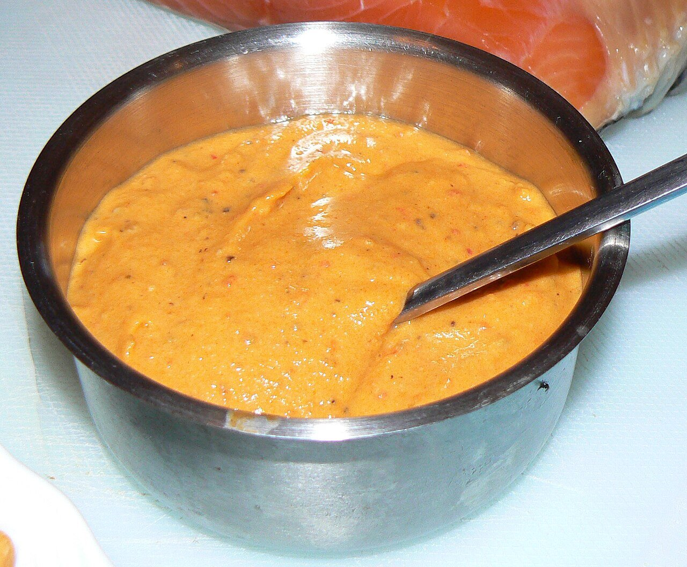

# Almogrote gomero

*Foto: [Flickr user sao mai](https://commons.wikimedia.org/wiki/File:Almogrote2.jpg), [CC BY-SA 2.0](https://creativecommons.org/licenses/by-sa/2.0/deed.es), vía Wikimedia Commons.*

Pasta untable de queso curado, ajo, pimienta y aceite, típica de La Gomera.

🥄 Para **6 personas** · ⏱️ 15 minutos · Dificultad: fácil

*In English:* [La Gomera aged cheese spread](almogrote.en.md)

## Ingredientes

- 250 g de queso de cabra curado y duro (gomero, si lo encuentras)
- 3 dientes de ajo
- 1–2 pimientas palmeras secas (o 1 guindilla y 1 cucharadita de pimentón)
- 1 tomate maduro pequeño, pelado (opcional)
- 100 ml de aceite de oliva

## Preparación

1. **La pimienta.** Quita las semillas a las pimientas y remójalas 15 minutos en agua templada.
2. **El queso.** Ralla el queso muy fino.
3. **Machacar.** En el mortero, machaca los ajos con la pimienta escurrida hasta hacer una pasta.
4. **Mezclar.** Añade el queso y el tomate, si lo usas, y ve incorporando el aceite poco a poco hasta tener una pasta untable. También se puede hacer con la batidora.

## Consejos

- **Para untar** en pan tostado o con papas arrugadas.
- **Aguanta varios días** en la nevera en un tarro tapado y cubierto con un poco de aceite.
- **Un queso muy seco** necesitará algo más de aceite.
