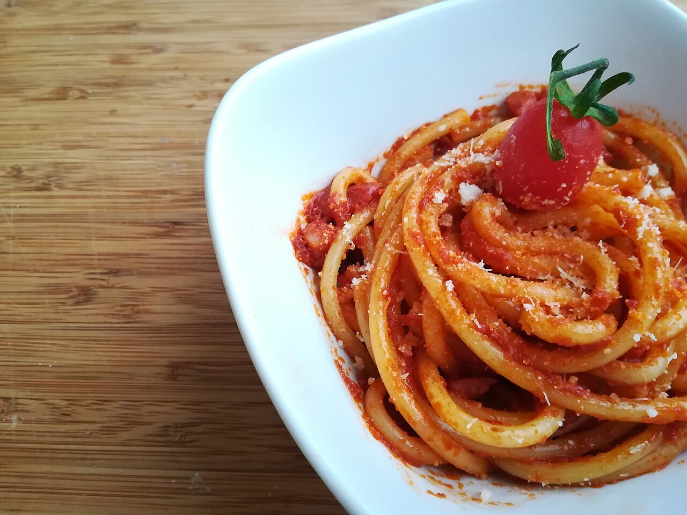

# Amatriciana sauce

*Photo: [Popo le Chien](https://commons.wikimedia.org/wiki/File:Bucatini_allamatriciana.jpg), [CC0](https://creativecommons.org/publicdomain/zero/1.0/), via Wikimedia Commons.*

Crisp guanciale, tomato and pecorino romano: the sauce from Amatrice for bucatini, with an optional pinch of chile.

🥄 Serves **4** · ⏱️ 30 minutes · Difficulty: easy

*En español:* [Salsa amatriciana](amatriciana.es.md)

## Ingredients

- 5 oz guanciale (or pancetta)
- 1 can (14 oz) whole peeled tomatoes, crushed by hand
- 3½ tablespoons dry white wine (optional)
- 1 small dried chile (optional)
- ⅔ cup grated pecorino romano
- Salt
- 14 oz bucatini or spaghetti

## Directions

1. **Guanciale.** Cut it into strips and render it in a dry skillet over medium heat until the fat runs and the edges are crisp. Remove half if you want it to stay crunchy.
2. **Wine.** If using, add it with the chile and let it cook off.
3. **Tomato.** Add the tomatoes and a pinch of salt and simmer 15 minutes, until thick.
4. **Pasta.** Cook the pasta al dente, drain and toss it in the sauce for 1 minute with a splash of pasta water.
5. **Cheese.** Off the heat, stir in the pecorino and serve with more on top.

## Tips

- **No garlic or onion:** the Amatrice recipe has neither.
- **Guanciale** is cured pork jowl; pancetta is the best substitute.
- **Go easy on salt:** guanciale and pecorino are already salty.
