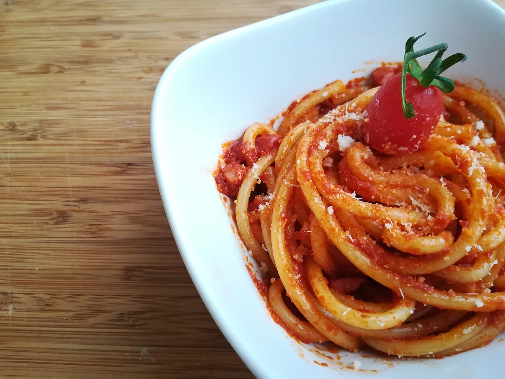

# Salsa amatriciana

*Foto: [Popo le Chien](https://commons.wikimedia.org/wiki/File:Bucatini_allamatriciana.jpg), [CC0](https://creativecommons.org/publicdomain/zero/1.0/deed.es), vía Wikimedia Commons.*

Guanciale crujiente, tomate y pecorino romano: la salsa de Amatrice para los bucatini, con un toque opcional de guindilla.

🥄 Para **4 personas** · ⏱️ 30 minutos · Dificultad: fácil

*In English:* [Amatriciana sauce](amatriciana.en.md)

## Ingredientes

- 150 g de guanciale (o panceta curada)
- 400 g de tomate pelado en lata, triturado a mano
- 50 ml de vino blanco (opcional)
- 1 guindilla seca pequeña (opcional)
- 60 g de pecorino romano rallado
- Sal
- 400 g de bucatini o espaguetis

## Preparación

1. **El guanciale.** Córtalo en tiras y dóralo en una sartén sin aceite, a fuego medio, hasta que suelte la grasa y esté crujiente por fuera. Retira la mitad si quieres que quede crujiente.
2. **El vino.** Si lo usas, añádelo con la guindilla y deja que se evapore.
3. **El tomate.** Añade el tomate y una pizca de sal y cuece 15 minutos a fuego medio, hasta que espese.
4. **La pasta.** Cuece la pasta al dente, escúrrela y saltéala en la salsa 1 minuto con un poco de su agua.
5. **El queso.** Fuera del fuego, añade el pecorino, mezcla y sirve con más queso por encima.

## Consejos

- **Sin ajo ni cebolla:** la receta de Amatrice no los lleva.
- **Guanciale** es papada de cerdo curada; la panceta es la mejor alternativa.
- **Sala poco:** el guanciale y el pecorino ya son salados.
