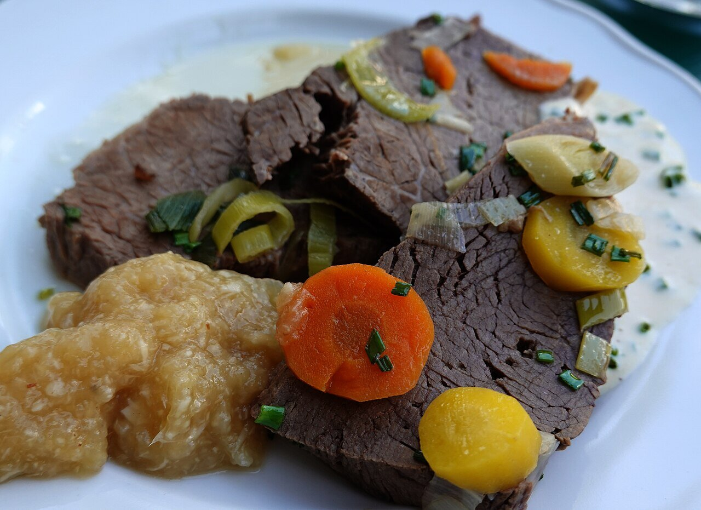

# Apfelkren (apple horseradish)

*Photo: [Geolina163](https://commons.wikimedia.org/wiki/File:Heuriger_Zum_Renner_Tafelspitz_Apfelkren.jpg), [CC BY-SA 4.0](https://creativecommons.org/licenses/by-sa/4.0/), via Wikimedia Commons.*

Grated tart apple with horseradish, lemon and a pinch of sugar: the cold Austrian sauce for tafelspitz (boiled beef), shown in the photo, and for sausages and ham.

🥄 Serves **4** · ⏱️ 10 minutes · Difficulty: easy

*En español:* [Apfelkren](apfelkren.es.md)

## Ingredients

- 2 tart apples (Granny Smith)
- 2 to 3 tablespoons freshly grated horseradish (or prepared)
- 1 tablespoon lemon juice
- 1 teaspoon sugar
- 1 tablespoon cider vinegar (optional)
- Pinch of salt

## Directions

1. **Lemon.** Put the lemon juice in a bowl so the apple doesn't brown.
2. **Apple.** Peel it and grate it finely straight into the lemon juice, stirring now and then.
3. **Horseradish.** Add the horseradish, sugar, salt and the vinegar, if using.
4. **Adjust.** Taste: it should be fresh and tangy, with a mild nose-tingling heat. Add more horseradish for a stronger kick.
5. **Serve.** Serve right away, cold, next to the boiled beef.

## Tips

- **Make it fresh:** grated apple browns within an hour; make it just before eating.
- **Prepared horseradish:** if it is in vinegar, leave the vinegar out of the recipe.
- **Milder:** stir in a spoonful of sour cream (then it is no longer vegan).
