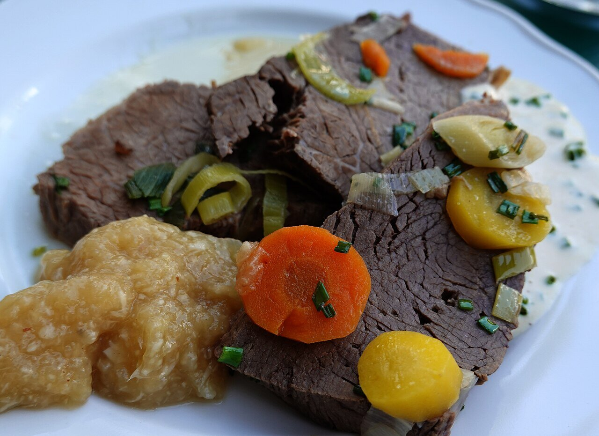

# Apfelkren

*Foto: [Geolina163](https://commons.wikimedia.org/wiki/File:Heuriger_Zum_Renner_Tafelspitz_Apfelkren.jpg), [CC BY-SA 4.0](https://creativecommons.org/licenses/by-sa/4.0/deed.es), vía Wikimedia Commons.*

Manzana ácida rallada con rábano picante, limón y una pizca de azúcar: la salsa fría austriaca del tafelspitz (ternera hervida), que aparece en la foto, y de las salchichas y el jamón cocido.

🥄 Para **4 personas** · ⏱️ 10 minutos · Dificultad: fácil

*In English:* [Apfelkren (apple horseradish)](apfelkren.en.md)

## Ingredientes

- 2 manzanas ácidas (Granny Smith o reineta)
- 2-3 cucharadas de rábano picante fresco rallado (o de bote)
- 1 cucharada de zumo de limón
- 1 cucharadita de azúcar
- 1 cucharada de vinagre de manzana (opcional)
- Una pizca de sal

## Preparación

1. **El limón.** Pon el zumo de limón en un cuenco para que la manzana no se oscurezca.
2. **La manzana.** Pélala y rállala fina directamente sobre el limón, mezclando de vez en cuando.
3. **El rábano.** Añade el rábano picante rallado, el azúcar, la sal y el vinagre si lo usas.
4. **Ajustar.** Prueba: debe ser fresca y ácida, con un picor de nariz suave. Añade más rábano si lo quieres más fuerte.
5. **Servir.** Sírvela enseguida, fría, junto a la carne hervida.

## Consejos

- **Al momento:** la manzana rallada se oxida en una hora; hazla justo antes de comer.
- **Rábano de bote:** si es en vinagre, quita el vinagre de la receta.
- **Más suave:** añade una cucharada de nata agria (ya no sería vegana).
