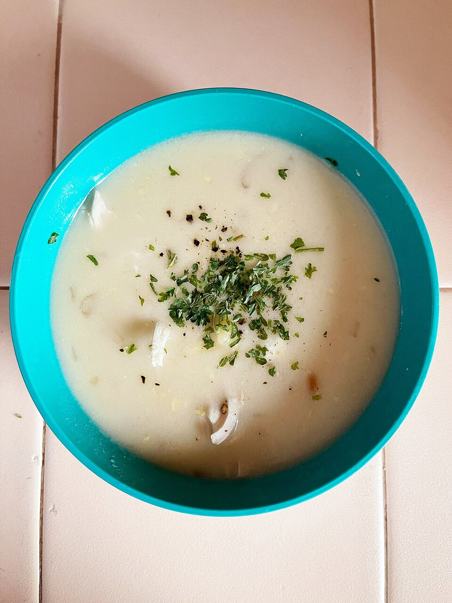

# Avgolemono sauce

*Photo: [Missvain](https://commons.wikimedia.org/wiki/File:Avgolemono_-_Sarah_Stierch.jpg), [CC BY 4.0](https://creativecommons.org/licenses/by/4.0/), via Wikimedia Commons.*

Egg and lemon juice thickened with hot broth: a creamy, tangy sauce for dolmades, meatballs, chicken or fish. The photo shows avgolemono soup, which is made with this same sauce.

🥄 Serves **4** · ⏱️ 15 minutes · Difficulty: medium

*En español:* [Salsa avgolémono](avgolemono.es.md)

## Ingredients

- 2 eggs
- Juice of 2 lemons (about ⅓ cup)
- 1¼ cups hot chicken, fish or vegetable broth
- 1 teaspoon cornstarch (optional, to keep it from curdling)
- Salt and white pepper
- Chopped dill (optional)

## Directions

1. **Eggs.** Whisk the eggs in a bowl until foamy. If using cornstarch, dissolve it in the lemon juice first.
2. **Lemon.** Add the lemon juice a little at a time, whisking constantly.
3. **Temper.** Pour in the hot broth a ladle at a time in a thin stream, still whisking, so the egg warms up without setting.
4. **Thicken.** Pour the mixture into a saucepan and heat over very low heat, stirring, 2 to 3 minutes, until it coats the spoon. Do not let it boil.
5. **Serve.** Season with salt and white pepper and add dill if you like. Serve right away.

## Tips

- **Don't boil it:** boiling curdles the egg and makes the sauce grainy.
- **Use the dish's own broth:** the liquid from the chicken stew or the dolmades adds flavor.
- **For soup:** double the broth and add cooked rice or orzo.
