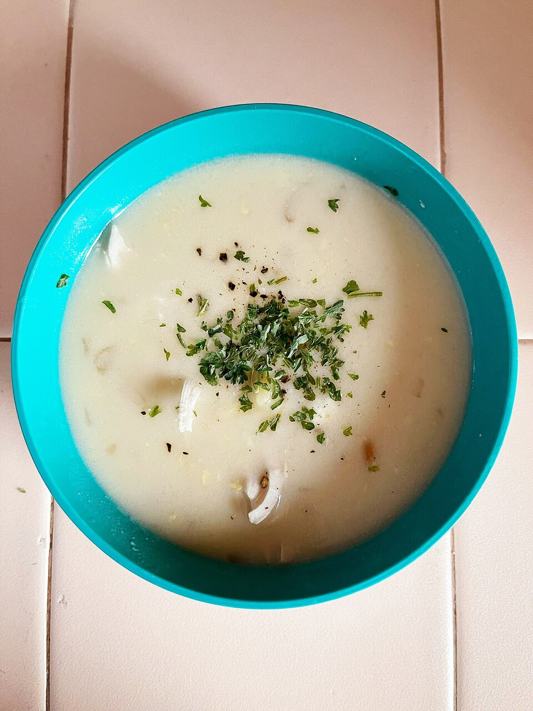

# Salsa avgolémono

*Foto: [Missvain](https://commons.wikimedia.org/wiki/File:Avgolemono_-_Sarah_Stierch.jpg), [CC BY 4.0](https://creativecommons.org/licenses/by/4.0/deed.es), vía Wikimedia Commons.*

Huevo y zumo de limón ligados con caldo caliente: una salsa cremosa y ácida para dolmades, albóndigas, pollo o pescado. En la foto, la sopa avgolémono, que se hace con esta misma salsa.

🥄 Para **4 personas** · ⏱️ 15 minutos · Dificultad: media

*In English:* [Avgolemono sauce](avgolemono.en.md)

## Ingredientes

- 2 huevos
- El zumo de 2 limones (unos 80 ml)
- 300 ml de caldo caliente de pollo, pescado o verduras
- 1 cucharadita de maicena (opcional, para que no se corte)
- Sal y pimienta blanca
- Eneldo picado (opcional)

## Preparación

1. **Los huevos.** Bate los huevos en un cuenco hasta que estén espumosos. Si usas maicena, disuélvela antes en el zumo de limón.
2. **El limón.** Añade el zumo de limón poco a poco, sin dejar de batir.
3. **Templar.** Vierte el caldo caliente en hilo, de cucharón en cucharón, batiendo siempre, para que el huevo se caliente sin cuajarse.
4. **Espesar.** Pasa la mezcla a un cazo y calienta a fuego muy suave, removiendo, 2 o 3 minutos, hasta que nape la cuchara. No dejes que hierva.
5. **Servir.** Sala, añade pimienta blanca y, si quieres, eneldo. Sírvela enseguida sobre el plato.

## Consejos

- **Que no hierva:** si hierve, el huevo se corta y la salsa queda granulosa.
- **Usa el caldo de la receta:** el del guiso de pollo o el de cocer los dolmades da más sabor.
- **Para sopa:** dobla el caldo y añade arroz o orzo cocido.
