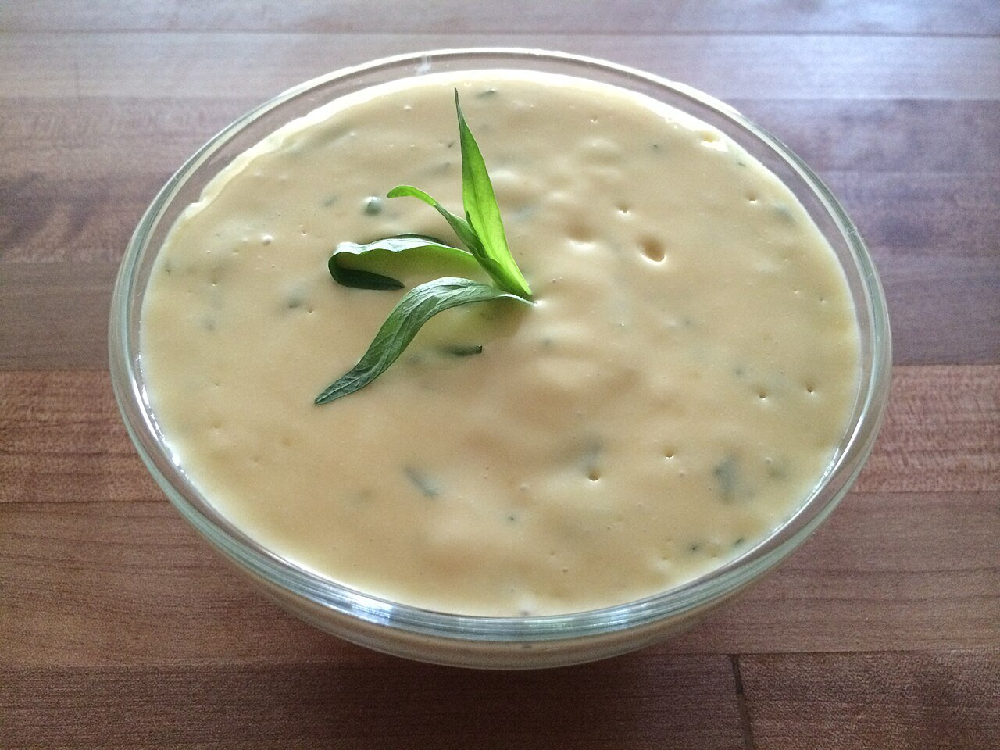

# Béarnaise sauce

*Photo: [Alexander Guy](https://commons.wikimedia.org/wiki/File:B%C3%A9arnaise_sauce_with_Tarragon_garnish.jpeg), [CC BY-SA 4.0](https://creativecommons.org/licenses/by-sa/4.0/), via Wikimedia Commons.*

Egg yolks emulsified with butter over a reduction of vinegar, shallot and tarragon: the sauce for steak frites.

🥄 Serves **4** · ⏱️ 30 minutes · Difficulty: hard

*En español:* [Salsa bearnesa (sauce béarnaise)](bearnaise.es.md)

## Ingredients

- 3 egg yolks
- 14 tablespoons (1¾ sticks) butter
- 2 shallots, very finely chopped
- 4 tablespoons white wine (or tarragon) vinegar
- 2 tablespoons dry white wine (optional)
- 2 tablespoons chopped fresh tarragon (plus a little to finish)
- Crushed white pepper
- Salt

## Directions

1. **Reduction.** Simmer the shallot, vinegar, wine, half the tarragon and the pepper until about 1 tablespoon of liquid remains. Let cool slightly.
2. **Butter.** Melt it and let it cool a little, skimming off the foam.
3. **Yolks.** Put the reduction and yolks with 1 tablespoon water in a bowl over barely simmering water. Whisk until thick and the whisk leaves trails, 3–4 minutes.
4. **Mount.** Off the heat, whisk in the warm butter in a very thin stream until thick and glossy.
5. **Finish.** Strain if you like, add the rest of the tarragon and salt. Serve warm.

## Tips

- **Serve with** steak, tenderloin, grilled fish, eggs or asparagus.
- **If it breaks:** whisk 1 tablespoon hot water in a clean bowl and slowly whisk in the broken sauce.
- **Alcohol-free:** skip the wine and use only vinegar.
