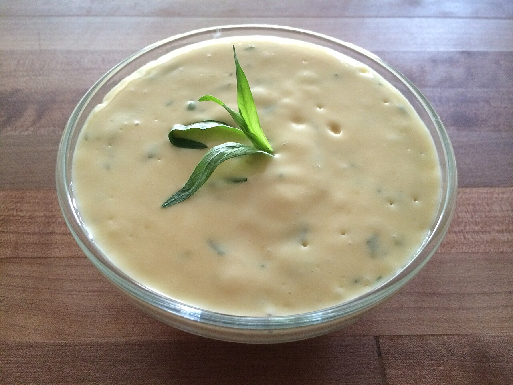

# Salsa bearnesa (sauce béarnaise)

*Foto: [Alexander Guy](https://commons.wikimedia.org/wiki/File:B%C3%A9arnaise_sauce_with_Tarragon_garnish.jpeg), [CC BY-SA 4.0](https://creativecommons.org/licenses/by-sa/4.0/deed.es), vía Wikimedia Commons.*

Yemas emulsionadas con mantequilla sobre una reducción de vinagre, chalota y estragón: la salsa del entrecot y las patatas fritas.

🥄 Para **4 personas** · ⏱️ 30 minutos · Dificultad: difícil

*In English:* [Béarnaise sauce](bearnaise.en.md)

## Ingredientes

- 3 yemas de huevo
- 200 g de mantequilla
- 2 chalotas picadas muy finas
- 4 cucharadas de vinagre de vino blanco (o de estragón)
- 2 cucharadas de vino blanco seco (opcional)
- 2 cucharadas de estragón fresco picado (más un poco para el final)
- Pimienta blanca machacada
- Sal

## Preparación

1. **La reducción.** Cuece la chalota, el vinagre, el vino, la mitad del estragón y la pimienta a fuego suave hasta que quede 1 cucharada de líquido. Deja templar.
2. **La mantequilla.** Fúndela y déjala templar, retirando la espuma de arriba.
3. **Las yemas.** Pon la reducción y las yemas con 1 cucharada de agua en un bol al baño maría, sin que el agua hierva. Bate hasta que espese y la varilla deje marcas, unos 3–4 minutos.
4. **Montar.** Fuera del fuego, añade la mantequilla templada en un hilo muy fino, batiendo sin parar, hasta que quede espesa y brillante.
5. **Terminar.** Cuela si quieres, añade el resto del estragón y sal. Sírvela templada.

## Consejos

- **Con** entrecot, solomillo, pescado a la plancha, huevos o espárragos.
- **Si se corta:** bate 1 cucharada de agua caliente en otro bol y añade la salsa cortada poco a poco.
- **Sin alcohol:** quita el vino y usa solo vinagre.
