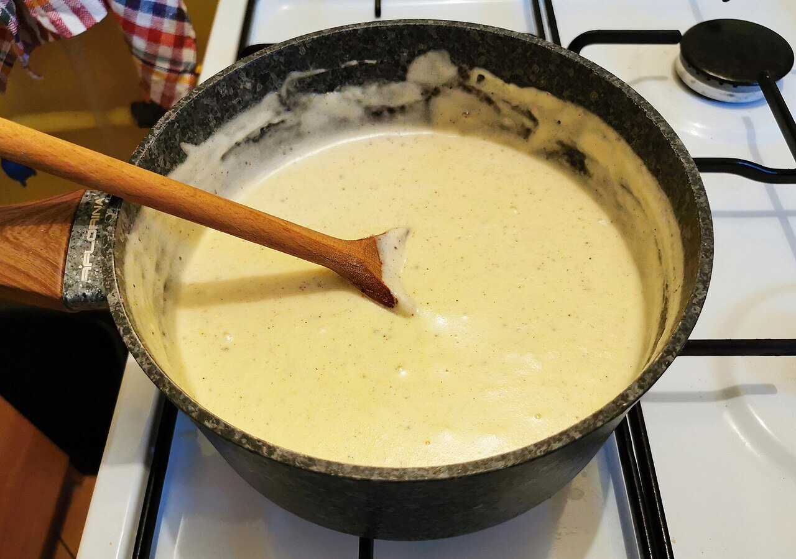

# Béchamel sauce

*Photo: [Jacek Halicki](https://commons.wikimedia.org/wiki/File:2021_Sos_beszamelowy.jpg), [CC BY-SA 4.0](https://creativecommons.org/licenses/by-sa/4.0/), via Wikimedia Commons.*

Butter, flour and milk with nutmeg: the white sauce for lasagna, cannelloni and croquettes, one of the French mother sauces.

🥄 Makes **about 2 cups** · ⏱️ 15 minutes · Difficulty: easy

*En español:* [Bechamel (sauce béchamel)](bechamel.es.md)

## Ingredients

- 3 tablespoons butter
- ⅓ cup all-purpose flour
- 2 cups whole milk
- 1 pinch nutmeg
- Salt

## Directions

1. **Roux.** Melt the butter over medium-low heat, add the flour and cook 2 minutes, stirring, without browning.
2. **Milk.** Gradually whisk in the hot milk so no lumps form.
3. **Thicken.** Simmer gently 5–8 minutes, stirring, until thick and no longer floury.
4. **Finish.** Add the nutmeg and salt.

## Tips

- **Thicker** (for croquettes): double the butter and flour for the same milk.
- **To prevent a skin:** press plastic wrap onto the surface.
- **Vegan:** use mild olive oil and unsweetened soy or oat milk.
