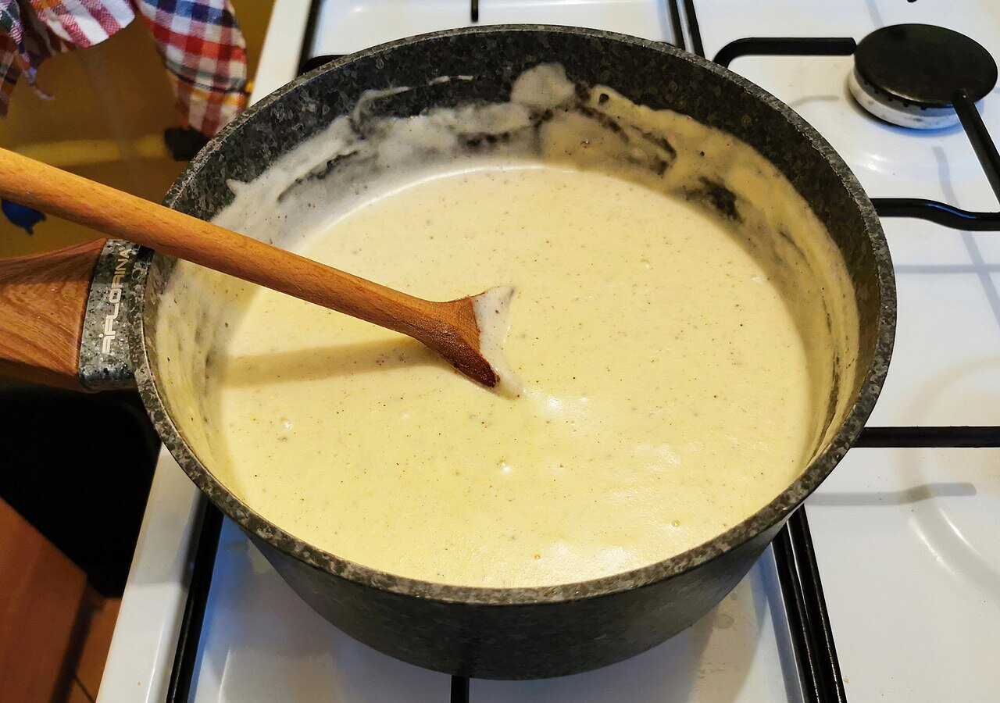

# Bechamel (sauce béchamel)

*Foto: [Jacek Halicki](https://commons.wikimedia.org/wiki/File:2021_Sos_beszamelowy.jpg), [CC BY-SA 4.0](https://creativecommons.org/licenses/by-sa/4.0/deed.es), vía Wikimedia Commons.*

Mantequilla, harina y leche con nuez moscada: la salsa blanca de las lasañas, los canelones y las croquetas, una de las salsas madre francesas.

🥄 Para **unos 500 ml** · ⏱️ 15 minutos · Dificultad: fácil

*In English:* [Béchamel sauce](bechamel.en.md)

## Ingredientes

- 40 g de mantequilla
- 40 g de harina
- 500 ml de leche entera
- 1 pizca de nuez moscada
- Sal

## Preparación

1. **El roux.** Funde la mantequilla a fuego medio-suave, añade la harina y cocínala 2 minutos removiendo, sin que tome color.
2. **La leche.** Añade la leche caliente poco a poco, batiendo con varillas para que no queden grumos.
3. **Espesar.** Cuece 5–8 minutos a fuego suave, removiendo, hasta que espese y pierda el sabor a harina.
4. **Terminar.** Añade la nuez moscada y la sal.

## Consejos

- **Más espesa** (para croquetas): 80 g de mantequilla y 80 g de harina por cada 500 ml de leche.
- **Para que no haga costra:** cúbrela con film pegado a la superficie.
- **Vegana:** usa aceite de oliva suave y bebida de soja o avena sin azúcar.
