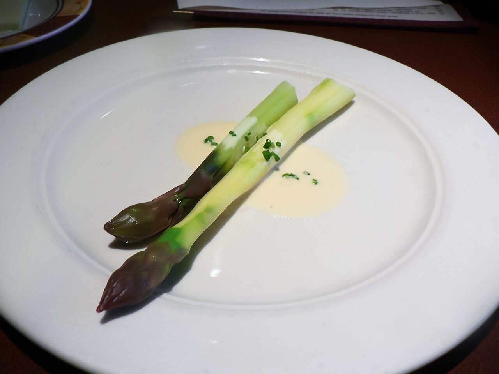

# French white butter sauce

*Photo: [stu_spivack](https://commons.wikimedia.org/wiki/File:Purple_asparagus_in_Beurre_blanc_sauce.jpg), [CC BY-SA 2.0](https://creativecommons.org/licenses/by-sa/2.0/), via Wikimedia Commons.*

A reduction of shallot, white wine and vinegar mounted with cold butter: the Loire Valley sauce for fish.

🥄 Serves **4** · ⏱️ 20 minutes · Difficulty: medium

*En español:* [Beurre blanc (mantequilla blanca)](beurre-blanc.es.md)

## Ingredients

- 2 shallots, very finely chopped
- Scant ½ cup dry white wine (Muscadet if possible)
- 3½ tablespoons white wine vinegar
- 14 tablespoons (1¾ sticks) very cold butter, cubed
- Salt and white pepper

## Directions

1. **Reduction.** Simmer the shallot with the wine and vinegar over medium heat until only 2 tablespoons of liquid remain.
2. **Mount.** Turn the heat to its lowest and whisk in the butter one cube at a time, waiting for each to melt before adding the next.
3. **Never boil.** If the sauce gets too hot, lift it off the heat for a moment while whisking.
4. **Finish.** Strain for a smooth sauce, season and serve right away.

## Tips

- **Serve with** white fish, salmon, scallops, asparagus or steamed vegetables.
- **Keep it warm** in a thermos or over very gentle heat; if it cools, it separates.
- **Alcohol-free:** use fish stock with a few drops of lemon instead of wine.
