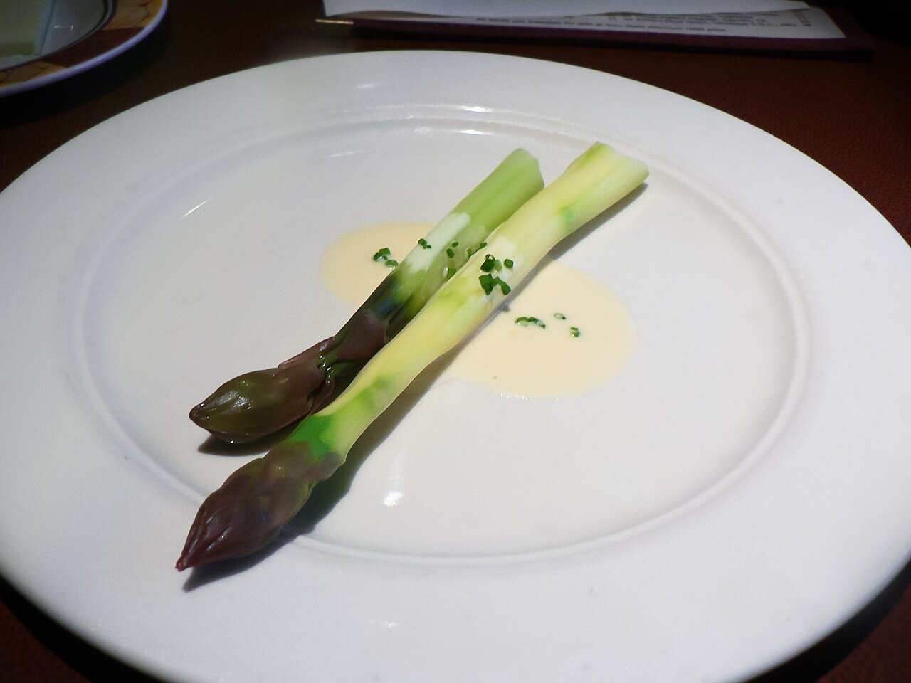

# Beurre blanc (mantequilla blanca)

*Foto: [stu_spivack](https://commons.wikimedia.org/wiki/File:Purple_asparagus_in_Beurre_blanc_sauce.jpg), [CC BY-SA 2.0](https://creativecommons.org/licenses/by-sa/2.0/deed.es), vía Wikimedia Commons.*

Reducción de chalota, vino blanco y vinagre montada con mantequilla fría: la salsa del Loira para el pescado.

🥄 Para **4 personas** · ⏱️ 20 minutos · Dificultad: media

*In English:* [French white butter sauce](beurre-blanc.en.md)

## Ingredientes

- 2 chalotas picadas muy finas
- 100 ml de vino blanco seco (muscadet, si puedes)
- 50 ml de vinagre de vino blanco
- 200 g de mantequilla muy fría, en dados
- Sal y pimienta blanca

## Preparación

1. **La reducción.** Cuece la chalota con el vino y el vinagre a fuego medio hasta que solo queden 2 cucharadas de líquido.
2. **Montar.** Baja el fuego al mínimo y añade la mantequilla dado a dado, batiendo sin parar. Espera a que cada dado se funda antes de añadir el siguiente.
3. **Sin hervir.** La salsa no debe hervir: si se calienta demasiado, apártala del fuego un momento mientras bates.
4. **Terminar.** Cuela si la quieres fina, salpimienta y sírvela enseguida.

## Consejos

- **Con** pescado blanco, salmón, vieiras, espárragos o verduras al vapor.
- **Mantenla templada** en un termo o al baño maría muy suave; si se enfría, se separa.
- **Sin alcohol:** cambia el vino por caldo de pescado con unas gotas de limón.
