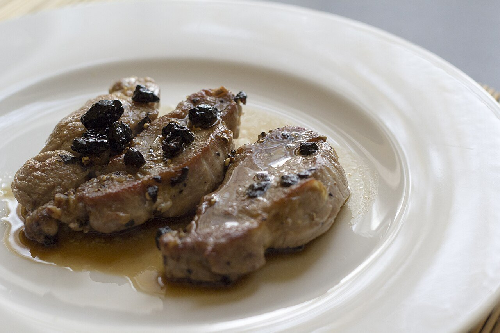

# Brandy mushroom cream sauce

*Photo: [Luca Nebuloni](https://commons.wikimedia.org/wiki/File:Pork_tenderloin_with_brandy_and_mirto_(32330684303).jpg), [CC BY 2.0](https://creativecommons.org/licenses/by/2.0/), via Wikimedia Commons.*

Flambéed Spanish brandy with shallot, mushrooms and cream: a sauce for pork or beef tenderloin.

🥄 Serves **4** · ⏱️ 20 minutes · Difficulty: easy

*En español:* [Salsa al brandy](brandy.es.md)

## Ingredients

- 1 shallot (or ½ onion)
- 7 oz mushrooms
- ¼ cup Spanish brandy
- Scant ½ cup beef stock
- ⅔ cup heavy cream
- 1 thyme sprig
- 1½ tablespoons butter
- 1 tablespoon olive oil
- Salt and pepper

## Directions

1. **Meat first.** If serving with tenderloin, sear it and set it aside. Make the sauce in the same pan to use the browned bits.
2. **Mushrooms.** Cook the chopped shallot in the butter and oil for 3 minutes. Add the sliced mushrooms and sauté over high heat until golden.
3. **Flambé.** Take the pan off the heat, add the brandy and carefully light it, away from the range hood. Let the flame die out on its own.
4. **Reduce.** Add the stock and thyme and reduce by half.
5. **Cream.** Add the cream and simmer 3–4 minutes, until it coats a spoon. Season and return the meat for a couple of minutes.

## Tips

- **Don't want to flambé?** Simmer the brandy for 2 minutes over medium heat to cook off the alcohol.
- **No cream:** whisk in cold butter at the end instead.
- **Safety:** never pour brandy straight from the bottle into a hot pan.
