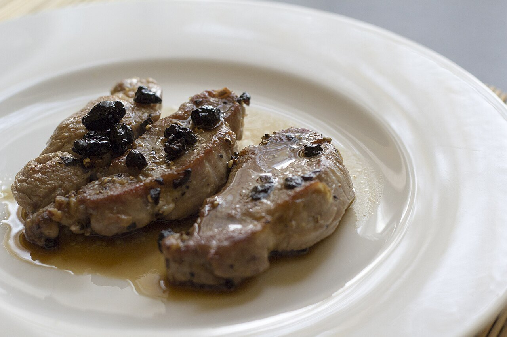

# Salsa al brandy

*Foto: [Luca Nebuloni](https://commons.wikimedia.org/wiki/File:Pork_tenderloin_with_brandy_and_mirto_(32330684303).jpg), [CC BY 2.0](https://creativecommons.org/licenses/by/2.0/deed.es), vía Wikimedia Commons.*

Brandy de Jerez flambeado con chalota, setas y nata: una salsa para solomillo de cerdo o de ternera.

🥄 Para **4 personas** · ⏱️ 20 minutos · Dificultad: fácil

*In English:* [Brandy mushroom cream sauce](brandy.en.md)

## Ingredientes

- 1 chalota (o ½ cebolla)
- 200 g de champiñones o setas
- 60 ml de brandy de Jerez
- 100 ml de caldo de carne
- 150 ml de nata para cocinar
- 1 ramita de tomillo
- 20 g de mantequilla
- 1 cucharada de aceite de oliva
- Sal y pimienta

## Preparación

1. **La carne primero.** Si es para solomillo, márcalo en la sartén y resérvalo. Haz la salsa en la misma sartén para aprovechar el fondo.
2. **Las setas.** Pocha la chalota picada en la mantequilla y el aceite 3 minutos. Añade las setas laminadas y saltéalas a fuego vivo hasta que se doren.
3. **Flambear.** Aparta la sartén del fuego, añade el brandy y préndelo con cuidado, lejos de la campana. Deja que la llama se apague sola.
4. **Reducir.** Añade el caldo y el tomillo y reduce a la mitad.
5. **La nata.** Añade la nata y cuece 3–4 minutos, hasta que napee. Ajusta de sal y pimienta y vuelve a meter la carne un par de minutos.

## Consejos

- **Si no quieres flambear,** cuece el brandy 2 minutos a fuego medio para que se evapore el alcohol.
- **Sin nata:** monta la salsa con mantequilla fría al final.
- **Seguridad:** nunca eches el brandy directamente de la botella sobre la sartén caliente.
