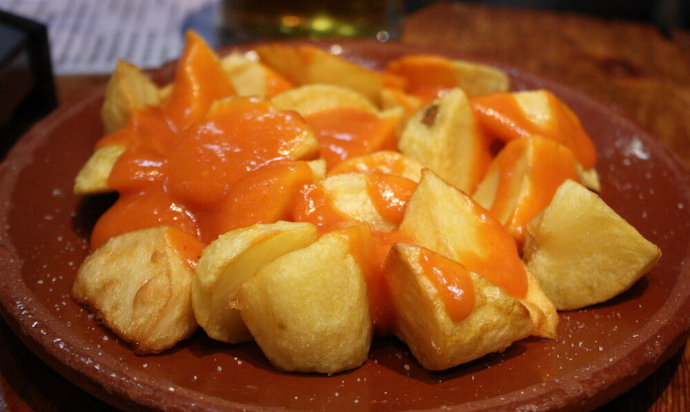

# Spicy paprika sauce

*Photo: [Krista](https://commons.wikimedia.org/wiki/File:Patatas_bravas_madrid_(cropped).jpg), [CC BY 2.0](https://creativecommons.org/licenses/by/2.0/), via Wikimedia Commons.*

The spicy sauce for patatas bravas, Madrid style: paprika, flour and stock, no tomato.

🥄 Serves **4** · ⏱️ 15 minutes · Difficulty: easy

*En español:* [Salsa brava](brava.es.md)

## Ingredients

- 3 tablespoons olive oil
- 1 tablespoon all-purpose flour
- 1 tablespoon sweet Spanish paprika
- 1 teaspoon hot Spanish paprika (or a pinch of cayenne)
- 1¼ cups chicken stock
- 1 teaspoon wine vinegar
- Salt

## Directions

1. **Roux.** Warm the oil over low heat and cook the flour for 1–2 minutes, stirring.
2. **Paprika.** Take the pan off the heat and stir in both paprikas.
3. **Stock.** Return to the heat and whisk in the stock gradually so no lumps form.
4. **Thicken.** Simmer 5–8 minutes until it coats a spoon. Add the vinegar and salt to taste.

## Tips

- **Pour over** rough-cut, twice-fried potatoes.
- **For a silky sauce,** strain it.
- **Adjust the heat** with more or less hot paprika or cayenne.
