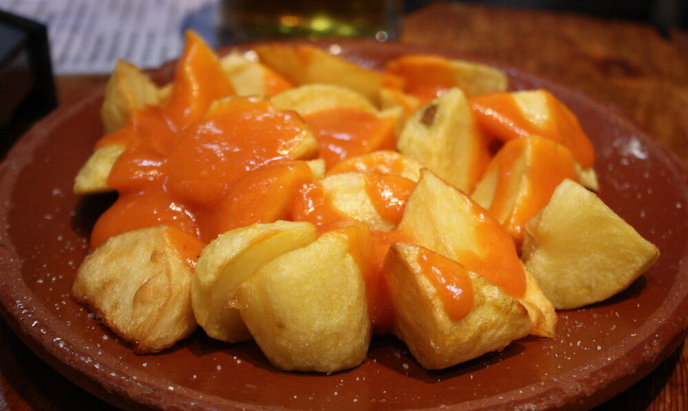

# Salsa brava

*Foto: [Krista](https://commons.wikimedia.org/wiki/File:Patatas_bravas_madrid_(cropped).jpg), [CC BY 2.0](https://creativecommons.org/licenses/by/2.0/deed.es), vía Wikimedia Commons.*

La salsa picante de las patatas bravas, al estilo de Madrid: pimentón, harina y caldo, sin tomate.

🥄 Para **4 personas** · ⏱️ 15 minutos · Dificultad: fácil

*In English:* [Spicy paprika sauce](brava.en.md)

## Ingredientes

- 3 cucharadas de aceite de oliva
- 1 cucharada de harina
- 1 cucharada de pimentón dulce
- 1 cucharadita de pimentón picante (o una pizca de cayena)
- 300 ml de caldo de pollo
- 1 cucharadita de vinagre de vino
- Sal

## Preparación

1. **El roux.** Calienta el aceite a fuego suave y tuesta la harina 1–2 minutos, removiendo.
2. **El pimentón.** Aparta del fuego y añade los dos pimentones removiendo bien.
3. **El caldo.** Vuelve al fuego y añade el caldo poco a poco, sin dejar de remover, para que no queden grumos.
4. **Espesar.** Cuece 5–8 minutos hasta que napee la cuchara. Añade el vinagre y sal al gusto.

## Consejos

- **Sobre patatas** cortadas en dados irregulares y fritas dos veces.
- **Más fina:** pásala por un colador.
- **Más o menos picante:** ajusta el pimentón picante o la cayena.
