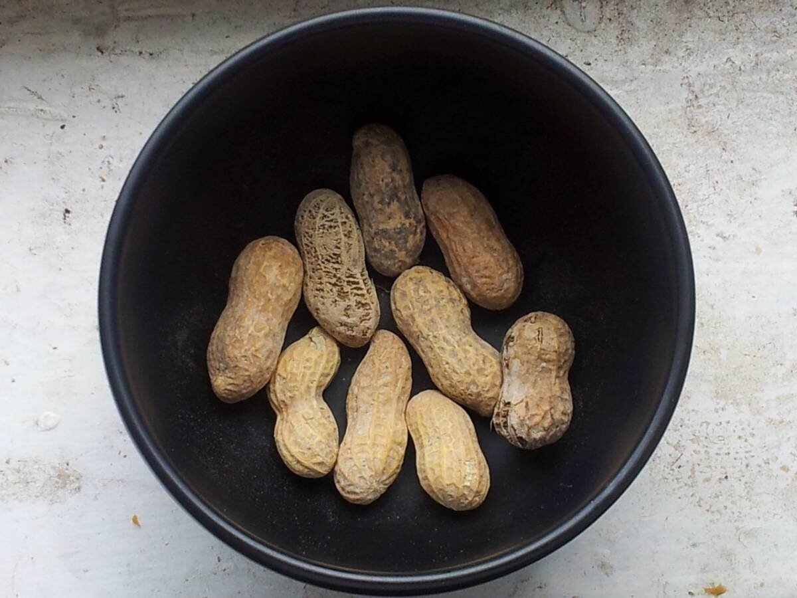

# Japanese peanut sauce

*Photo: [Monika M. Wahi](https://commons.wikimedia.org/wiki/File:Peanuts_in_a_bowl..jpg), [CC BY-SA 3.0](https://creativecommons.org/licenses/by-sa/3.0/), via Wikimedia Commons.*

Peanut butter, soy sauce, rice vinegar and sesame oil: a Japanese sauce for dipping shabu-shabu or dressing cold noodles and tofu. The photo shows the peanuts, not the sauce.

🥄 Serves **4** · ⏱️ 10 minutes · Difficulty: easy

*En español:* [Salsa japonesa de cacahuete](cacahuete.es.md)

## Ingredients

- 3 tablespoons natural, unsweetened peanut butter
- 2 tablespoons soy sauce
- 1 tablespoon rice vinegar
- 1 tablespoon sugar
- 1 teaspoon toasted sesame oil
- 3–4 tablespoons dashi or warm water
- 1 tablespoon chopped roasted peanuts, to serve

## Directions

1. **Dissolve.** In a bowl, stir the peanut butter with the sugar and soy sauce until smooth.
2. **Thin.** Gradually stir in the vinegar and dashi until it has the texture of a light cream.
3. **Sesame.** Add the sesame oil and taste. Adjust soy sauce (salt), sugar or vinegar.
4. **Serve.** Serve in small bowls topped with the chopped peanuts.

## Tips

- **Serve with** shabu-shabu, hiyashi chuka (cold noodles), tofu, poached chicken or steamed vegetables.
- **If the peanut butter is stiff,** warm the dashi or water.
- **Vegan:** use water or kombu dashi instead of bonito dashi.
