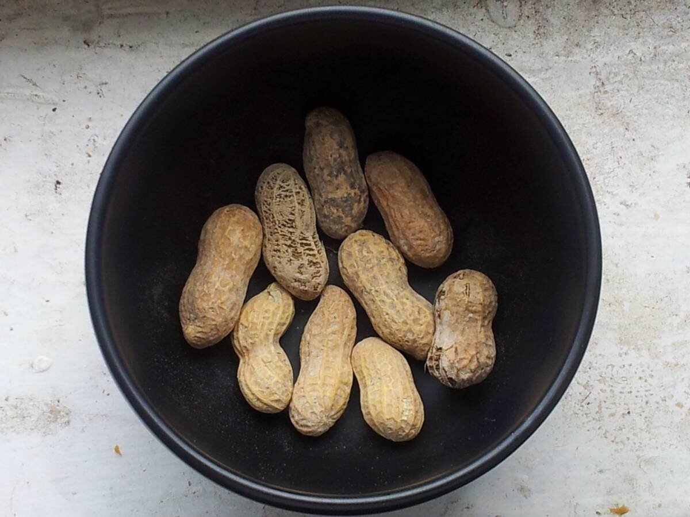

# Salsa japonesa de cacahuete

*Foto: [Monika M. Wahi](https://commons.wikimedia.org/wiki/File:Peanuts_in_a_bowl..jpg), [CC BY-SA 3.0](https://creativecommons.org/licenses/by-sa/3.0/deed.es), vía Wikimedia Commons.*

Crema de cacahuete, salsa de soja, vinagre de arroz y aceite de sésamo: una salsa japonesa para mojar en el shabu-shabu, aliñar fideos fríos o tofu. La foto muestra los cacahuetes, no la salsa.

🥄 Para **4 personas** · ⏱️ 10 minutos · Dificultad: fácil

*In English:* [Japanese peanut sauce](cacahuete.en.md)

## Ingredientes

- 3 cucharadas de crema de cacahuete natural, sin azúcar
- 2 cucharadas de salsa de soja
- 1 cucharada de vinagre de arroz
- 1 cucharada de azúcar
- 1 cucharadita de aceite de sésamo tostado
- 3–4 cucharadas de dashi o de agua templada
- 1 cucharada de cacahuetes tostados picados, para servir

## Preparación

1. **Disolver.** En un bol, mezcla la crema de cacahuete con el azúcar y la salsa de soja hasta que quede lisa.
2. **Aclarar.** Añade el vinagre y el dashi poco a poco, removiendo, hasta que la salsa tenga la textura de una crema ligera.
3. **El sésamo.** Añade el aceite de sésamo y prueba. Ajusta de soja (sal), azúcar o vinagre.
4. **Servir.** Sírvela en cuencos individuales con los cacahuetes picados por encima.

## Consejos

- **Con** shabu-shabu, hiyashi chuka (fideos fríos), tofu, pollo cocido o verduras al vapor.
- **Si la crema de cacahuete está dura,** templa el dashi o el agua.
- **Vegana:** usa agua o dashi de kombu en lugar de dashi de bonito.
