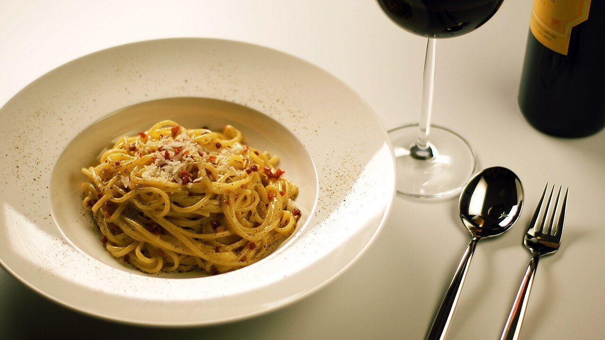

# Carbonara sauce

*Photo: [Mattes Boch (Mboch on English Wikipedia)](https://commons.wikimedia.org/wiki/File:Spaghetti_alla_Carbonara.jpg), public domain, via Wikimedia Commons.*

Egg yolks, pecorino, black pepper and guanciale, bound by the heat of the pasta: Roman carbonara, with no cream.

🥄 Serves **4** · ⏱️ 20 minutes · Difficulty: medium

*En español:* [Salsa carbonara](carbonara.es.md)

## Ingredients

- 5 oz guanciale (or pancetta)
- 4 egg yolks plus 1 whole egg
- ¾ cup grated pecorino romano (or half parmesan)
- Freshly ground black pepper
- 14 oz spaghetti or rigatoni

## Directions

1. **Guanciale.** Cut it into strips and crisp it in a dry skillet. Turn off the heat and leave the fat in the pan.
2. **Cream.** Whisk the yolks and egg with the cheese and plenty of pepper into a thick cream.
3. **Pasta.** Cook it al dente in lightly salted water. Save a cup of the cooking water.
4. **Bind.** Add the drained pasta to the skillet with the guanciale, off the heat, and wait 30 seconds. Add the egg mixture and toss quickly with a splash of pasta water until creamy and glossy.
5. **Serve.** Serve right away with more cheese and pepper.

## Tips

- **No cream:** the creaminess comes from egg, cheese and pasta water.
- **If it scrambles,** the heat was on or the pan too hot: always do it off the heat.
- **Food safety:** the egg is lightly cooked; use very fresh or pasteurized eggs.
