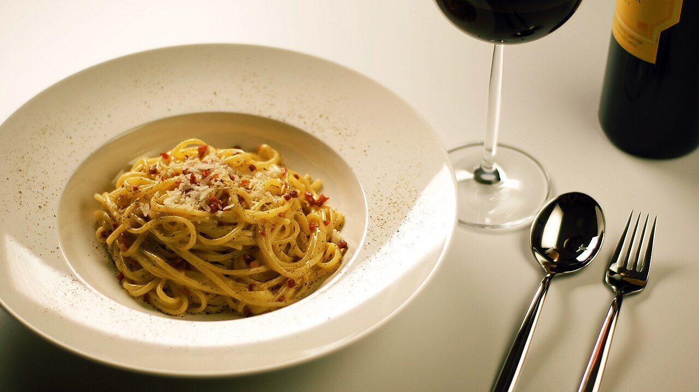

# Salsa carbonara

*Foto: [Mattes Boch (Mboch on English Wikipedia)](https://commons.wikimedia.org/wiki/File:Spaghetti_alla_Carbonara.jpg), dominio público, vía Wikimedia Commons.*

Yemas de huevo, pecorino, pimienta negra y guanciale, ligados con el calor de la pasta: la carbonara romana, sin nata.

🥄 Para **4 personas** · ⏱️ 20 minutos · Dificultad: media

*In English:* [Carbonara sauce](carbonara.en.md)

## Ingredientes

- 150 g de guanciale (o panceta curada)
- 4 yemas y 1 huevo entero
- 80 g de pecorino romano rallado (o mitad parmesano)
- Pimienta negra recién molida
- 400 g de espaguetis o rigatoni

## Preparación

1. **El guanciale.** Córtalo en tiras y dóralo en una sartén sin aceite hasta que esté crujiente. Apaga el fuego y deja la grasa en la sartén.
2. **La crema.** Bate las yemas y el huevo con el queso y mucha pimienta hasta tener una crema espesa.
3. **La pasta.** Cuécela al dente en agua con poca sal. Guarda un vaso del agua de cocción.
4. **Ligar.** Echa la pasta escurrida en la sartén con el guanciale, fuera del fuego, y espera 30 segundos. Añade la crema de huevo y mezcla rápido, con un chorrito del agua de cocción, hasta que quede cremosa y brillante.
5. **Servir.** Sirve enseguida con más queso y pimienta.

## Consejos

- **Sin nata:** la cremosidad sale del huevo, el queso y el agua de la pasta.
- **Si cuaja,** el fuego estaba encendido o la sartén muy caliente: hazlo siempre fuera del fuego.
- **Seguridad:** el huevo queda poco cocinado; usa huevos muy frescos o pasteurizados.
