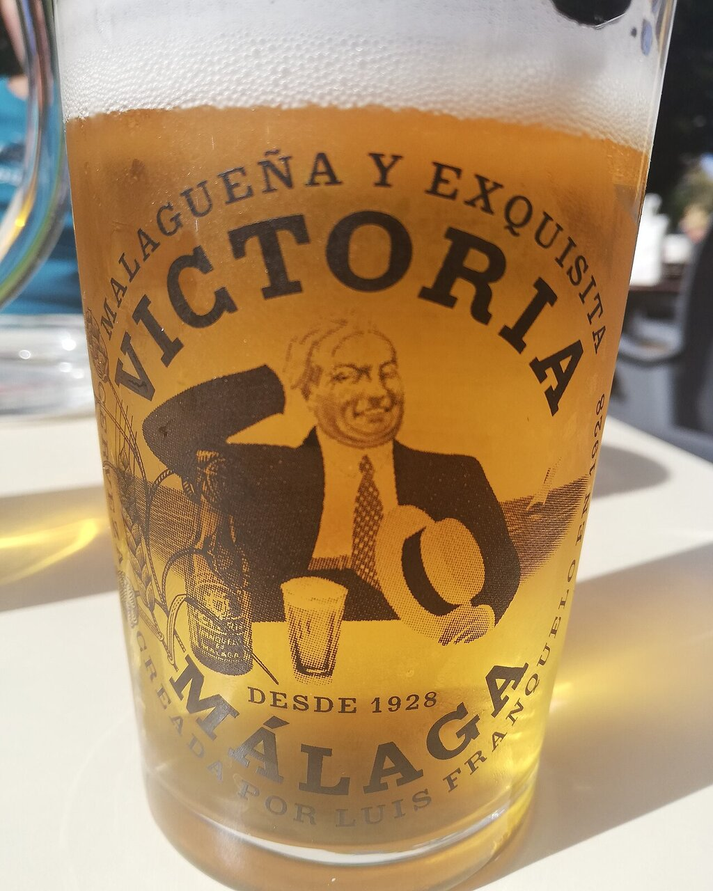

# Beer braising sauce

*Photo: [Bildfinder](https://commons.wikimedia.org/wiki/File:Ca%C3%B1a_de_cerveza_Victor%C3%ADa.jpg), [CC BY-SA 4.0](https://creativecommons.org/licenses/by-sa/4.0/), via Wikimedia Commons.*

Slowly cooked onion, lager, mustard and bay leaf: the sauce for Spanish chicken, pork cheeks or ribs braised in beer. The photo shows the beer, not the dish.

🥄 Serves **4** · ⏱️ 1 hour · Difficulty: easy

*En español:* [Salsa a la cerveza](cerveza.es.md)

## Ingredients

- 1 chicken, cut up (or 2¼ lb pork cheeks or ribs)
- 2 onions
- 2 garlic cloves
- 1 carrot
- 1 bottle (12 oz) lager
- 1 teaspoon mustard
- 1 teaspoon honey or brown sugar (optional)
- 1 bay leaf
- All-purpose flour, for dredging
- 5 tablespoons olive oil
- Salt and pepper

## Directions

1. **Brown.** Season and dredge the meat in flour, brown it in the oil and set aside.
2. **Vegetables.** In the same pot, gently cook the chopped onion, garlic and carrot for about 15 minutes.
3. **Beer.** Return the meat, pour in the beer and boil 2–3 minutes to cook off the alcohol. Add the mustard, honey and bay leaf.
4. **Braise.** Cover and simmer 35–40 minutes for chicken (1 h 30 min for pork cheeks or ribs), turning the meat now and then.
5. **Sauce.** Lift out the meat, remove the bay leaf and blend the sauce. Reduce it if thin and return the meat.

## Tips

- **Use a lager or amber ale,** not a very hoppy beer: bitterness concentrates as it reduces.
- **Serve with** fries, mashed potatoes or white rice.
- **Even better the next day,** like most stews.
