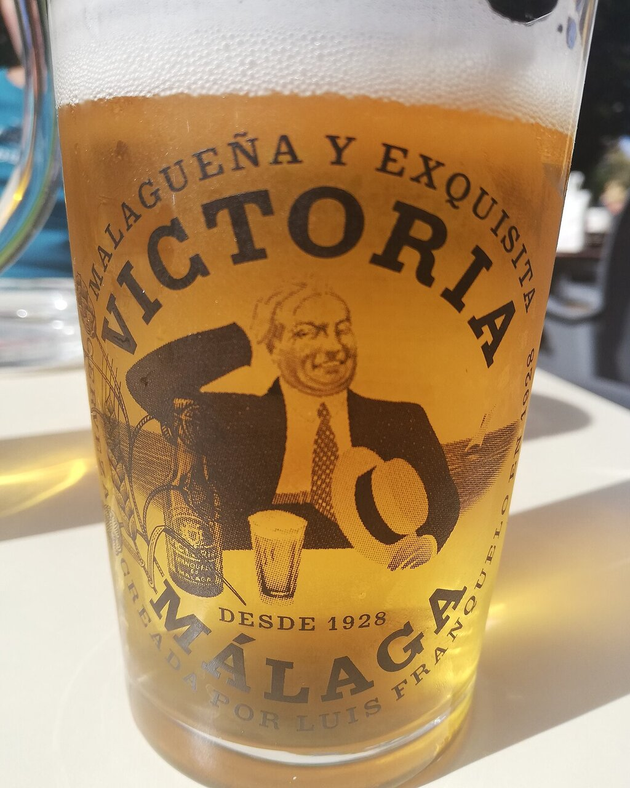

# Salsa a la cerveza

*Foto: [Bildfinder](https://commons.wikimedia.org/wiki/File:Ca%C3%B1a_de_cerveza_Victor%C3%ADa.jpg), [CC BY-SA 4.0](https://creativecommons.org/licenses/by-sa/4.0/deed.es), vía Wikimedia Commons.*

Cebolla pochada, cerveza rubia, mostaza y laurel: la salsa del pollo, las carrilleras o las costillas a la cerveza. La foto muestra la cerveza, no el plato.

🥄 Para **4 personas** · ⏱️ 1 hora · Dificultad: fácil

*In English:* [Beer braising sauce](cerveza.en.md)

## Ingredientes

- 1 pollo troceado (o 1 kg de carrilleras o costillas de cerdo)
- 2 cebollas
- 2 dientes de ajo
- 1 zanahoria
- 330 ml de cerveza rubia (un botellín)
- 1 cucharadita de mostaza
- 1 cucharadita de miel o azúcar moreno (opcional)
- 1 hoja de laurel
- Harina, para enharinar
- 5 cucharadas de aceite de oliva
- Sal y pimienta

## Preparación

1. **Dorar.** Salpimienta y enharina la carne, dórala en el aceite y retírala.
2. **Las verduras.** En la misma cazuela, pocha la cebolla, el ajo y la zanahoria picados a fuego suave unos 15 minutos.
3. **La cerveza.** Vuelve a meter la carne, moja con la cerveza y deja que hierva 2–3 minutos para que pierda el alcohol. Añade la mostaza, la miel y el laurel.
4. **Guisar.** Tapa y cuece a fuego suave 35–40 minutos para el pollo (1 h 30 min para carrilleras o costillas), dando la vuelta a la carne de vez en cuando.
5. **La salsa.** Saca la carne, retira el laurel y tritura la salsa. Redúcela si está líquida y vuelve a meter la carne.

## Consejos

- **Mejor rubia o tostada** que muy lupulada: el amargor se concentra al reducir.
- **Con** patatas fritas, puré o arroz blanco.
- **Mejor de un día para otro,** como casi todos los guisos.
