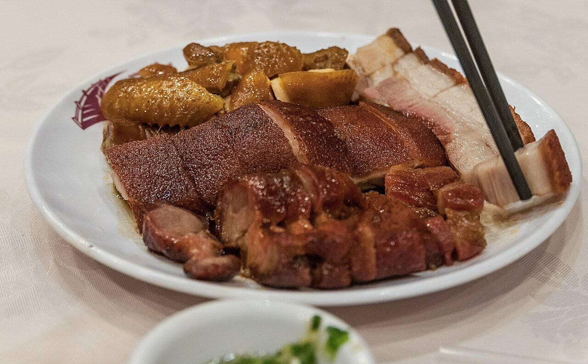

# Char siu sauce

*Photo: [Wilfredor](https://commons.wikimedia.org/wiki/File:Soy_sauce_chicken,_siu_yuk_and_char_siu_in_Hong_Kong_-_20130614.jpg), [CC0](https://creativecommons.org/publicdomain/zero/1.0/), via Wikimedia Commons.*

Hoisin, soy sauce, honey, Shaoxing wine and five-spice: the marinade and glaze for Cantonese roast pork, red and lacquered. The photo shows char siu next to other Hong Kong roast meats.

🥄 Serves **4** (2 lb meat) · ⏱️ 10 minutes + marinating · Difficulty: easy

*En español:* [Salsa char siu](char-siu.es.md)

## Ingredients

- 3 tablespoons hoisin sauce
- 2 tablespoons light soy sauce
- 1 tablespoon dark soy sauce
- 3 tablespoons honey (plus 2 for glazing)
- 2 tablespoons Shaoxing wine
- 1 tablespoon brown sugar
- ½ teaspoon Chinese five-spice powder
- 2 garlic cloves, grated
- 1 teaspoon toasted sesame oil

## Directions

1. **Mix.** Whisk all the ingredients in a bowl until the honey and sugar dissolve.
2. **Marinate.** Cut 2 lb pork shoulder or collar into thick strips, coat with half the sauce and refrigerate at least 4 hours, ideally overnight.
3. **Reduce.** Boil the other half in a small saucepan for 3 minutes, until slightly thick. This is the glaze.
4. **Roast.** Roast the pork on a rack at 400 °F for 30 to 35 minutes, turning and brushing with glaze every 10 minutes.
5. **Lacquer.** At the end, brush with honey and broil 2 to 3 minutes, until caramelized. Slice to serve.

## Tips

- **Alcohol-free:** replace the Shaoxing wine with broth or water and a few drops of rice vinegar.
- **Red color:** the classic color comes from fermented red bean curd; without it the pork is darker but just as good.
- **Put water in the pan** under the rack so the drippings don't burn.
