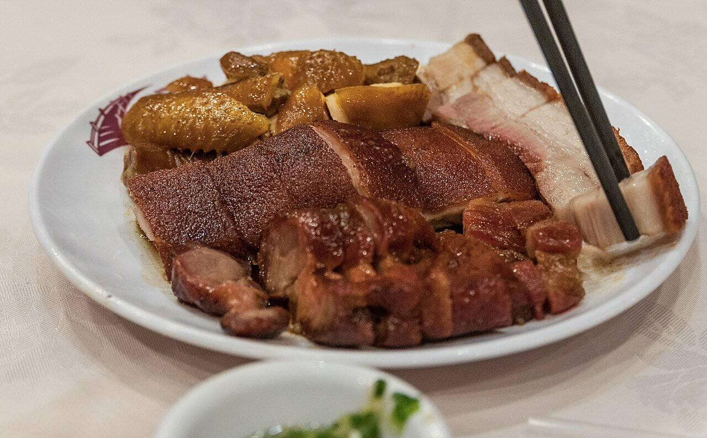

# Salsa char siu

*Foto: [Wilfredor](https://commons.wikimedia.org/wiki/File:Soy_sauce_chicken,_siu_yuk_and_char_siu_in_Hong_Kong_-_20130614.jpg), [CC0](https://creativecommons.org/publicdomain/zero/1.0/deed.es), vía Wikimedia Commons.*

Hoisin, soja, miel, vino de Shaoxing y cinco especias: el adobo y glaseado del cerdo asado cantonés, rojizo y lacado. En la foto, char siu junto a otras carnes asadas de Hong Kong.

🥄 Para **4 personas** (1 kg de carne) · ⏱️ 10 minutos + adobo · Dificultad: fácil

*In English:* [Char siu sauce](char-siu.en.md)

## Ingredientes

- 3 cucharadas de salsa hoisin
- 2 cucharadas de salsa de soja clara
- 1 cucharada de salsa de soja oscura
- 3 cucharadas de miel (y 2 más para glasear)
- 2 cucharadas de vino de Shaoxing
- 1 cucharada de azúcar moreno
- ½ cucharadita de cinco especias chinas
- 2 dientes de ajo rallados
- 1 cucharadita de aceite de sésamo

## Preparación

1. **Mezclar.** Bate todos los ingredientes en un cuenco hasta que la miel y el azúcar se disuelvan.
2. **Adobar.** Corta 1 kg de presa o aguja de cerdo en tiras gruesas, cúbrelas con la mitad de la salsa y déjalas en la nevera al menos 4 horas, mejor toda la noche.
3. **Reducir.** Hierve la otra mitad en un cazo 3 minutos, hasta que espese un poco. Será el glaseado.
4. **Asar.** Asa la carne sobre una rejilla a 200 °C 30-35 minutos, dándole la vuelta y pincelándola con el glaseado cada 10 minutos.
5. **Lacar.** Al final, pincela con miel y gratina 2-3 minutos, hasta que se caramelice. Córtala en lonchas.

## Consejos

- **Sin alcohol:** cambia el vino de Shaoxing por caldo o agua con unas gotas de vinagre de arroz.
- **Color rojo:** el tradicional sale de la cuajada de soja roja fermentada; sin ella queda más oscuro, pero igual de bueno.
- **Pon agua en la bandeja** de debajo para que los jugos no se quemen.
