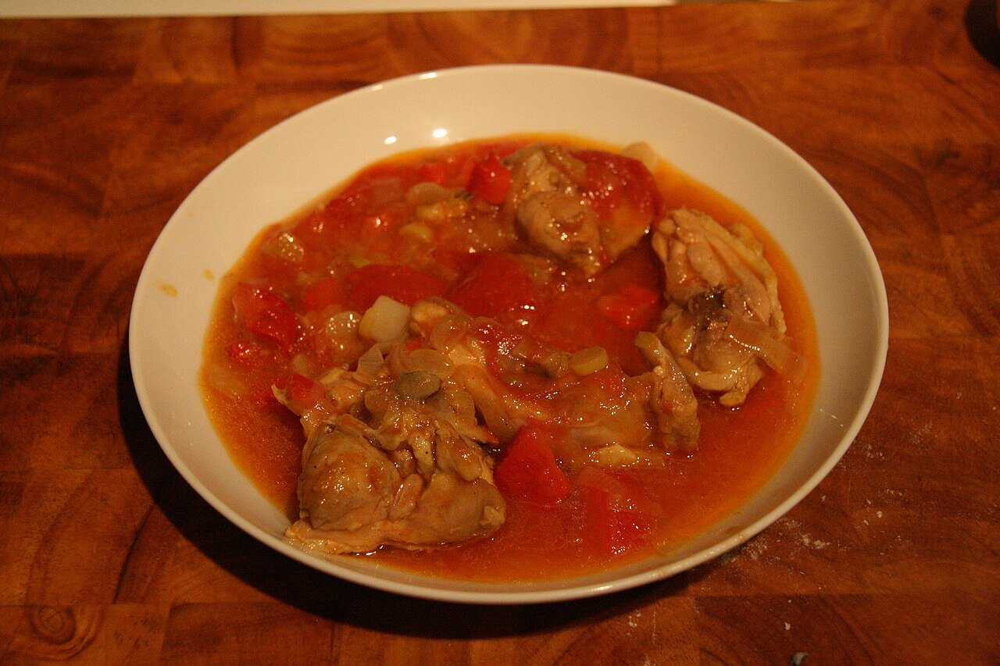

# Red pepper, tomato and ham sauce

*Photo: [Tamorlan](https://commons.wikimedia.org/wiki/File:Chilindr%C3%B3n_-_Pollo.jpg), [CC BY-SA 3.0](https://creativecommons.org/licenses/by-sa/3.0/), via Wikimedia Commons.*

Peppers, tomato, onion and serrano ham: the sauce for chicken or lamb chilindrón from Aragon, Navarre and La Rioja.

🥄 Serves **4** · ⏱️ 50 minutes · Difficulty: easy

*En español:* [Salsa chilindrón](chilindron.es.md)

## Ingredients

- 3 dried choricero peppers (or dried ancho chiles)
- 1 onion
- 2 garlic cloves
- 1 red bell pepper
- 1 can (14 oz) crushed tomatoes
- 2 oz serrano ham, diced
- Scant ½ cup dry white wine
- 4 tablespoons olive oil
- Salt

## Directions

1. **Dried peppers.** Soak them in hot water for 30 minutes and scrape out the flesh with a spoon.
2. **Base.** Gently cook the chopped onion, garlic and bell pepper for about 15 minutes.
3. **Ham.** Add the ham and cook 2 minutes.
4. **Tomato.** Add the wine and let it cook off. Stir in the tomato and pepper flesh and simmer 20 minutes.
5. **Add the meat.** Add browned chicken or lamb and finish cooking it in the sauce.

## Tips

- **Chicken chilindrón:** brown 1 cut-up chicken first and simmer it 30–40 minutes in the sauce.
- **Even better the next day.**
- **No dried peppers?** Use 1 tablespoon sweet paprika, though the flavor changes.
