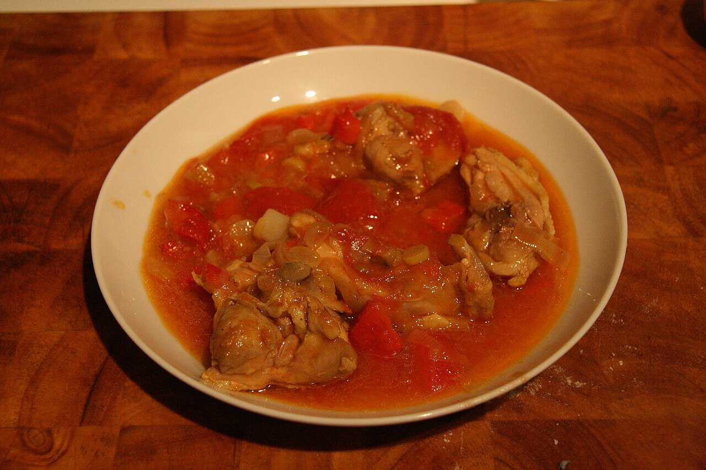

# Salsa chilindrón

*Foto: [Tamorlan](https://commons.wikimedia.org/wiki/File:Chilindr%C3%B3n_-_Pollo.jpg), [CC BY-SA 3.0](https://creativecommons.org/licenses/by-sa/3.0/deed.es), vía Wikimedia Commons.*

Pimiento, tomate, cebolla y jamón: la salsa del pollo y el cordero al chilindrón de Aragón, Navarra y La Rioja.

🥄 Para **4 personas** · ⏱️ 50 minutos · Dificultad: fácil

*In English:* [Red pepper, tomato and ham sauce](chilindron.en.md)

## Ingredientes

- 3 pimientos choriceros secos (o 1 cucharada de carne de pimiento choricero)
- 1 cebolla
- 2 dientes de ajo
- 1 pimiento rojo
- 400 g de tomate triturado
- 50 g de jamón serrano en taquitos
- 100 ml de vino blanco
- 4 cucharadas de aceite de oliva
- Sal

## Preparación

1. **Los choriceros.** Remójalos 30 minutos en agua caliente y raspa la carne con una cuchara.
2. **El sofrito.** Pocha a fuego suave la cebolla, el ajo y el pimiento rojo, todo picado, unos 15 minutos.
3. **El jamón.** Añade el jamón y rehógalo 2 minutos.
4. **El tomate.** Añade el vino y deja que se evapore. Incorpora el tomate y la carne de choricero y cuece 20 minutos a fuego suave.
5. **Con la carne.** Mete el pollo o el cordero ya dorado y termina de guisar en la salsa.

## Consejos

- **Pollo al chilindrón:** dora 1 pollo troceado antes y guísalo 30–40 minutos en la salsa.
- **Mejor de un día para otro.**
- **Sin choricero:** usa una cucharada de pimentón dulce, aunque cambia el sabor.
