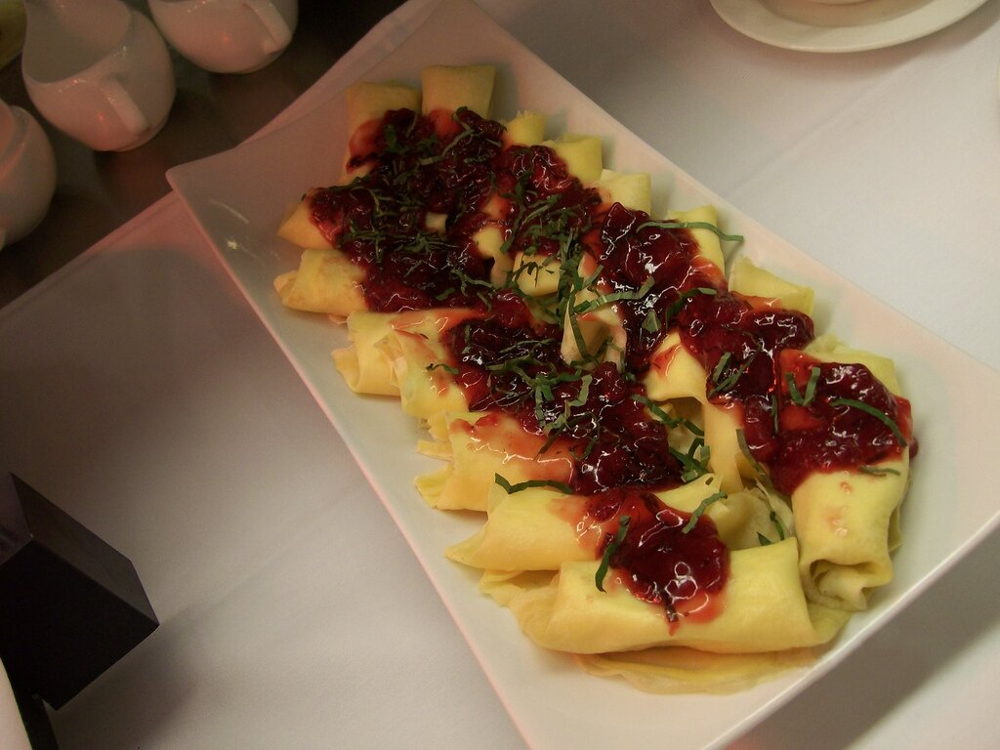

# Cumberland sauce

*Photo: [Daniel Sexton](https://commons.wikimedia.org/wiki/File:Duck_confit_crepes_with_Cumberland_sauce.jpg), [CC BY-SA 2.0](https://creativecommons.org/licenses/by-sa/2.0/), via Wikimedia Commons.*

Red currant jelly, port, orange, lemon and mustard: the cold English sauce for ham, duck, game and pâtés. The photo shows it with duck confit crêpes.

🥄 Serves **6** · ⏱️ 20 minutes · Difficulty: easy

*En español:* [Salsa Cumberland](cumberland.es.md)

## Ingredients

- 1 orange and 1 lemon (zest and juice)
- 1 shallot, finely chopped
- ⅔ cup red currant jelly
- ½ cup ruby port
- 1 teaspoon dry mustard or Dijon
- Pinch of ground ginger
- Salt and pepper

## Directions

1. **Zest.** Peel the orange and lemon without the white pith and cut the peel into very thin strips. Blanch them with the shallot in boiling water for 2 minutes and drain.
2. **Base.** Melt the currant jelly in a saucepan over low heat.
3. **Port.** Add the port, mustard, ginger and the orange and lemon juice and simmer 5 minutes.
4. **Combine.** Add the zest and shallot, season and simmer 2 minutes more.
5. **Cool.** Let it cool: it thickens as it cools. Serve cold or at room temperature.

## Tips

- **Alcohol-free:** replace the port with red grape juice and a few drops of balsamic vinegar.
- **Christmas:** it is the classic sauce for the English Christmas ham.
- **Keeps 2 weeks** in a closed jar in the fridge.
