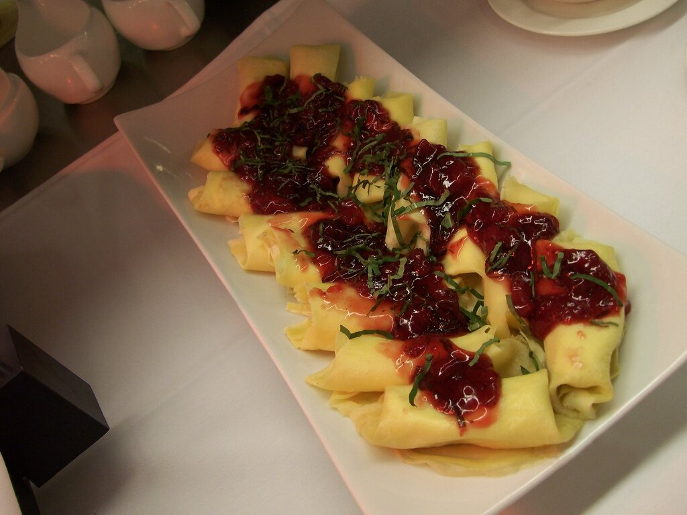

# Salsa Cumberland

*Foto: [Daniel Sexton](https://commons.wikimedia.org/wiki/File:Duck_confit_crepes_with_Cumberland_sauce.jpg), [CC BY-SA 2.0](https://creativecommons.org/licenses/by-sa/2.0/deed.es), vía Wikimedia Commons.*

Jalea de grosellas rojas, oporto, naranja, limón y mostaza: la salsa fría inglesa para el jamón, el pato, la caza y los patés. En la foto, con crepes de confit de pato.

🥄 Para **6 personas** · ⏱️ 20 minutos · Dificultad: fácil

*In English:* [Cumberland sauce](cumberland.en.md)

## Ingredientes

- 1 naranja y 1 limón (piel y zumo)
- 1 chalota picada fina
- 200 g de jalea de grosellas rojas
- 120 ml de oporto tinto
- 1 cucharadita de mostaza en polvo o de Dijon
- Una pizca de jengibre molido
- Sal y pimienta

## Preparación

1. **Las pieles.** Pela la naranja y el limón sin la parte blanca y córtalas en tiras muy finas. Escáldalas con la chalota 2 minutos en agua hirviendo y escúrrelas.
2. **La base.** En un cazo, derrite la jalea de grosellas a fuego suave.
3. **El oporto.** Añade el oporto, la mostaza, el jengibre y los zumos de naranja y limón, y cuece 5 minutos.
4. **Juntar.** Añade las pieles y la chalota, salpimienta y cuece 2 minutos más.
5. **Enfriar.** Déjala enfriar: espesa al enfriarse. Se sirve fría o a temperatura ambiente.

## Consejos

- **Sin alcohol:** cambia el oporto por zumo de uva tinta con unas gotas de vinagre balsámico.
- **Navidad:** es la salsa del jamón asado navideño en Inglaterra.
- **Dura 2 semanas** en la nevera en un tarro cerrado.
