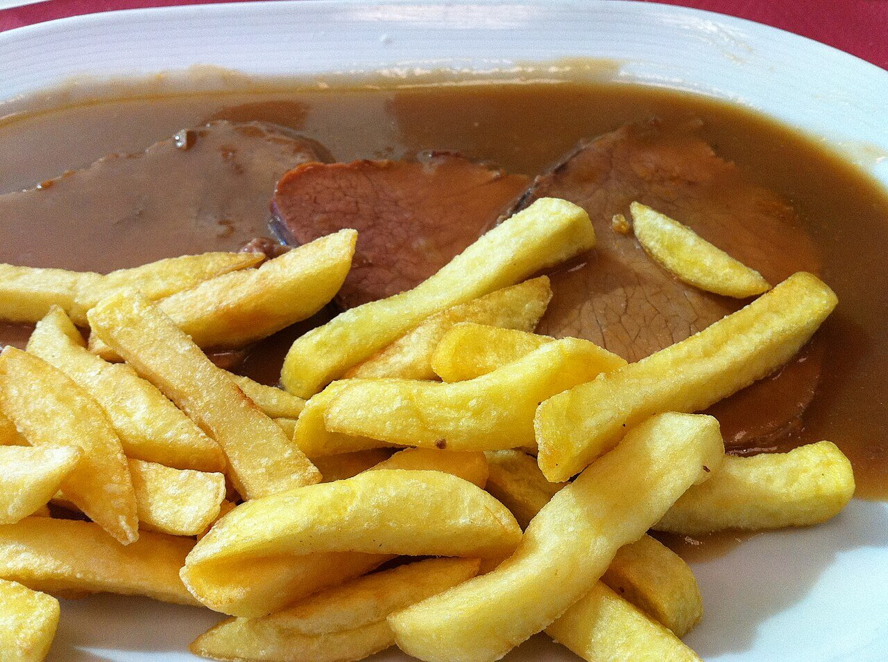

# Classic brown sauce

*Photo: [Tamorlan](https://commons.wikimedia.org/wiki/File:Sauce_Spagnole-09.JPG), [CC BY-SA 3.0](https://creativecommons.org/licenses/by-sa/3.0/), via Wikimedia Commons.*

A dark sauce of beef stock, browned vegetables and roux. It's one of the classic mother sauces, and in Spain it's widely used for braised meats, meat patties and tongue.

🥄 Makes **about 2 cups** · ⏱️ 1 h 30 min · Difficulty: medium

*En español:* [Salsa española](espanola.es.md)

## Ingredients

- 1 onion
- 1 carrot
- 1 leek (white part)
- 3 tablespoons butter (or olive oil)
- ⅓ cup all-purpose flour
- 1 tablespoon tomato paste
- ⅔ cup dry red wine
- 4 cups dark beef stock
- 1 bay leaf, 1 thyme sprig and a few parsley stems
- Salt and pepper

## Directions

1. **Vegetables.** Chop the onion, carrot and leek and brown them well in the butter, about 10 minutes.
2. **Roux.** Add the flour and cook, stirring, until it turns hazelnut brown.
3. **Tomato and wine.** Stir in the tomato paste for 1 minute, then pour in the wine and let it reduce.
4. **Reduce.** Add the hot stock and herbs and simmer gently for 1 hour, skimming, until reduced by half.
5. **Strain.** Press through a fine strainer and season with salt and pepper.

## Tips

- **Dark stock** is made from oven-roasted beef bones; the better the stock, the better the sauce.
- **Freezes well** in portions.
- **A base for other sauces,** like mushroom or red wine sauce.
