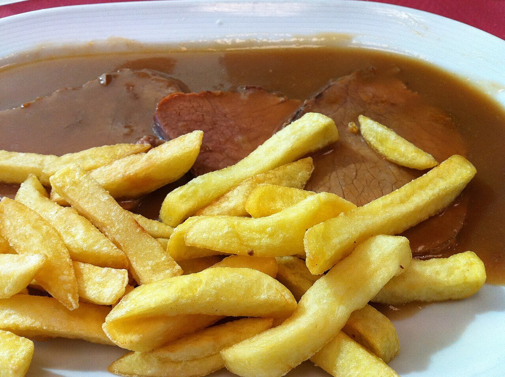

# Salsa española

*Foto: [Tamorlan](https://commons.wikimedia.org/wiki/File:Sauce_Spagnole-09.JPG), [CC BY-SA 3.0](https://creativecommons.org/licenses/by-sa/3.0/deed.es), vía Wikimedia Commons.*

Salsa oscura de caldo de carne, verduras tostadas y roux. Es una de las salsas madre de la cocina clásica, y en España se usa mucho con carnes guisadas, filetes rusos y lengua.

🥄 Para **unos 500 ml** · ⏱️ 1 h 30 min · Dificultad: media

*In English:* [Classic brown sauce](espanola.en.md)

## Ingredientes

- 1 cebolla
- 1 zanahoria
- 1 puerro (la parte blanca)
- 40 g de mantequilla (o aceite de oliva)
- 40 g de harina
- 1 cucharada de tomate concentrado
- 150 ml de vino tinto
- 1 litro de caldo oscuro de carne
- 1 hoja de laurel, 1 ramita de tomillo y unos tallos de perejil
- Sal y pimienta

## Preparación

1. **Las verduras.** Pica la cebolla, la zanahoria y el puerro y dóralas bien en la mantequilla, unos 10 minutos.
2. **El roux.** Añade la harina y tuéstala removiendo hasta que tome color avellana.
3. **El tomate y el vino.** Añade el tomate concentrado, remueve 1 minuto y moja con el vino. Deja reducir.
4. **Reducir.** Añade el caldo caliente y las hierbas y cuece a fuego suave 1 hora, desespumando, hasta que quede la mitad.
5. **Colar.** Pásala por un colador fino apretando las verduras. Ajusta de sal y pimienta.

## Consejos

- **Caldo oscuro:** hecho con huesos de ternera tostados al horno; cuanto mejor el caldo, mejor la salsa.
- **Se congela** muy bien en porciones.
- **Base de otras salsas,** como la de champiñones o la de vino tinto.
