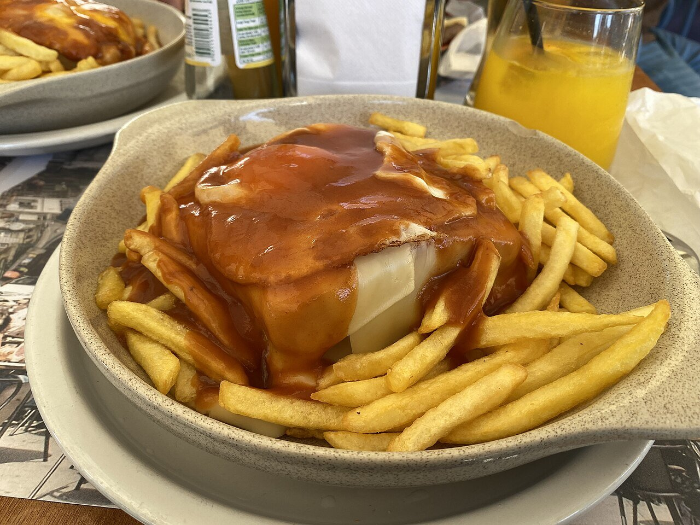

# Francesinha sauce

*Photo: [DgOlsen](https://commons.wikimedia.org/wiki/File:FrancesinhaNoPorto.jpg), [CC BY-SA 4.0](https://creativecommons.org/licenses/by-sa/4.0/), via Wikimedia Commons.*

Tomato, beer, port and beef broth, thickened and strained: the orange sauce poured over the francesinha from Porto, the cheese-topped meat sandwich.

🥄 Makes enough for **4 francesinhas** · ⏱️ 40 minutes · Difficulty: medium

*En español:* [Salsa de francesinha](francesinha.es.md)

## Ingredients

- 2 tablespoons butter
- 1 onion and 2 garlic cloves, chopped
- 1 bay leaf
- ¾ cup crushed tomatoes
- 1 bottle (12 oz) lager
- ¼ cup port (or brandy)
- 1¼ cups beef broth
- 1 tablespoon cornstarch mixed with a little water
- 1 teaspoon sweet paprika
- A few drops of piri-piri or hot sauce (optional)
- Salt

## Directions

1. **Base.** Soften the onion and garlic in the butter with the bay leaf for 10 minutes, without browning.
2. **Tomato.** Add the tomatoes and paprika and cook 5 minutes.
3. **Liquids.** Add the beer, port and broth and simmer 20 minutes over medium heat.
4. **Strain.** Remove the bay leaf, blend and strain until smooth.
5. **Thicken.** Bring back to a boil, stir in the cornstarch and season with salt. Add as little hot sauce as you like, or none. Pour it hot over the francesinha.

## Tips

- **Mild:** in Porto it is usually a bit spicy; here the piri-piri is optional and added last.
- **More flavor:** add the meat drippings to the broth, or a seafood bouillon cube, as some cooks do.
- **With fries:** the extra sauce is for dipping them.
