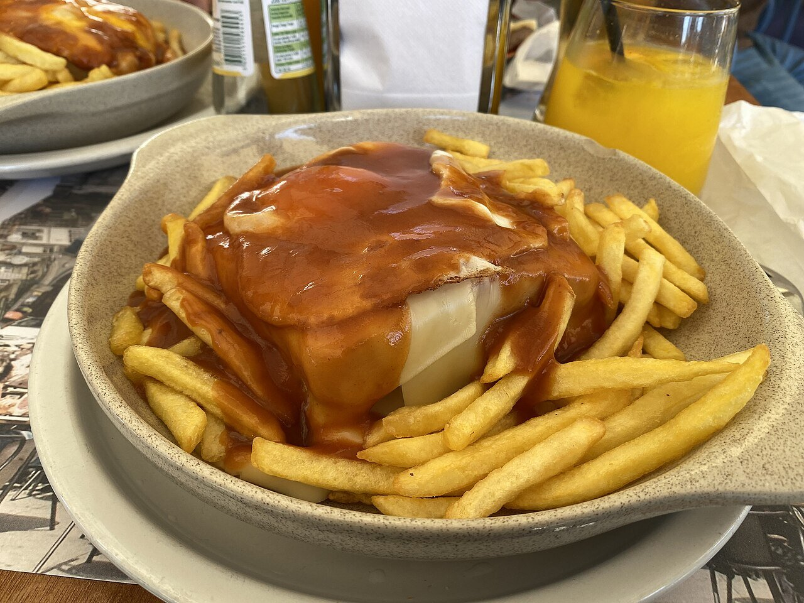

# Salsa de francesinha

*Foto: [DgOlsen](https://commons.wikimedia.org/wiki/File:FrancesinhaNoPorto.jpg), [CC BY-SA 4.0](https://creativecommons.org/licenses/by-sa/4.0/deed.es), vía Wikimedia Commons.*

Tomate, cerveza, oporto y caldo de carne, espesados y colados: la salsa anaranjada que baña la francesinha de Oporto, el sándwich de carnes gratinado con queso.

🥄 Para **4 francesinhas** · ⏱️ 40 minutos · Dificultad: media

*In English:* [Francesinha sauce](francesinha.en.md)

## Ingredientes

- 2 cucharadas de mantequilla
- 1 cebolla y 2 dientes de ajo picados
- 1 hoja de laurel
- 200 g de tomate triturado
- 330 ml de cerveza rubia
- 60 ml de oporto (o brandy)
- 300 ml de caldo de carne
- 1 cucharada de maicena disuelta en un poco de agua
- 1 cucharadita de pimentón dulce
- Unas gotas de piri-piri o tabasco (opcional)
- Sal

## Preparación

1. **El sofrito.** Pocha la cebolla y el ajo en la mantequilla con el laurel 10 minutos, sin que se doren.
2. **El tomate.** Añade el tomate y el pimentón y cuece 5 minutos.
3. **Los líquidos.** Añade la cerveza, el oporto y el caldo, y cuece 20 minutos a fuego medio.
4. **Colar.** Quita el laurel, tritura y cuela para que quede fina.
5. **Espesar.** Vuelve a hervir, liga con la maicena y sala. Añade el picante al gusto, poco o nada. Viértela caliente sobre la francesinha.

## Consejos

- **Poco picante:** en Oporto suele picar algo; aquí el piri-piri es opcional y va al final.
- **Más sabor:** añade al caldo los jugos de la carne o una pastilla de marisco, como hacen algunas casas.
- **Con patatas fritas:** la salsa sobrante es para mojarlas.
