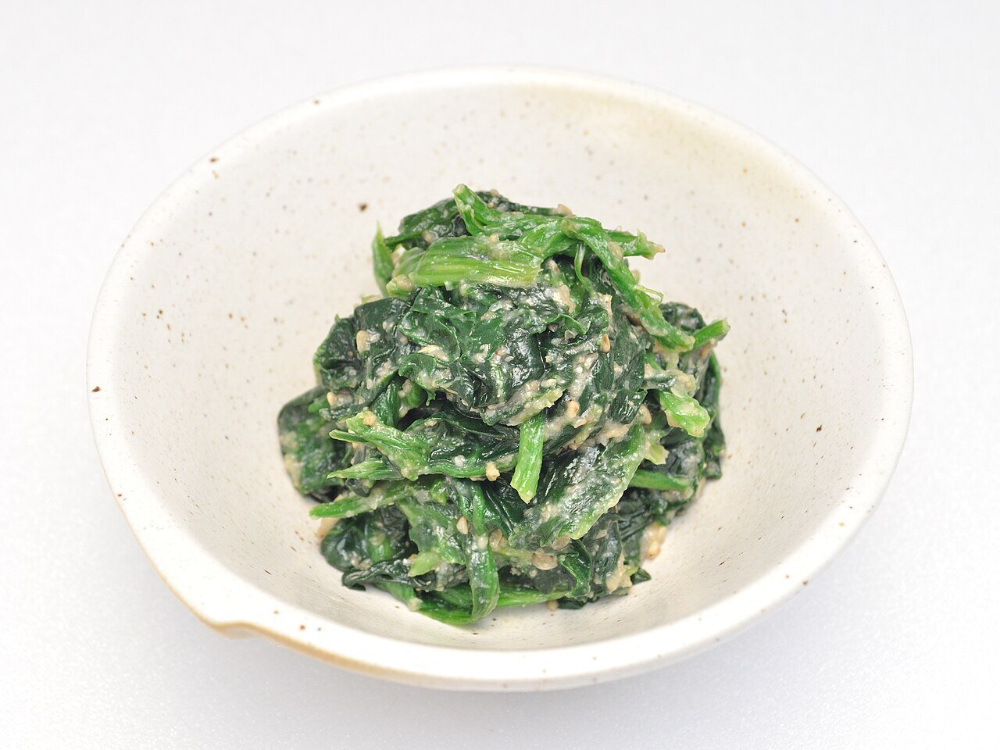

# Japanese sesame dressing for greens

*Photo: [Ocdp](https://commons.wikimedia.org/wiki/File:Spinach_Goma-ae_001.jpg), [CC0](https://creativecommons.org/publicdomain/zero/1.0/), via Wikimedia Commons.*

Toasted ground sesame with soy sauce and sugar: the Japanese dressing for goma-ae spinach and green beans.

🥄 Serves **4** · ⏱️ 10 minutes · Difficulty: easy

*En español:* [Aliño goma-ae (sésamo para verduras)](goma-ae.es.md)

## Ingredients

- 4 tablespoons white sesame seeds
- 1½ tablespoons soy sauce
- 1 tablespoon sugar
- 1 teaspoon mirin (optional)
- 1 teaspoon toasted sesame oil (optional)
- 10 oz spinach (or green beans, or broccoli)

## Directions

1. **Toast.** Toast the sesame in a dry pan over medium-low heat, shaking, until fragrant and lightly golden. Don't let it burn.
2. **Grind.** Grind it in a mortar (suribachi) until about half the seeds are broken and it starts to release oil.
3. **Dressing.** Add the sugar, soy sauce, mirin and sesame oil and mix into a moist paste.
4. **Greens.** Blanch the spinach 30–60 seconds, plunge into ice water, squeeze very dry and cut into pieces.
5. **Dress.** Toss the greens with the dressing just before serving.

## Tips

- **Squeeze the spinach well:** extra water dilutes the dressing.
- **Alcohol-free:** skip the mirin and add a pinch more sugar.
- **Black sesame** works the same way and tastes stronger.
