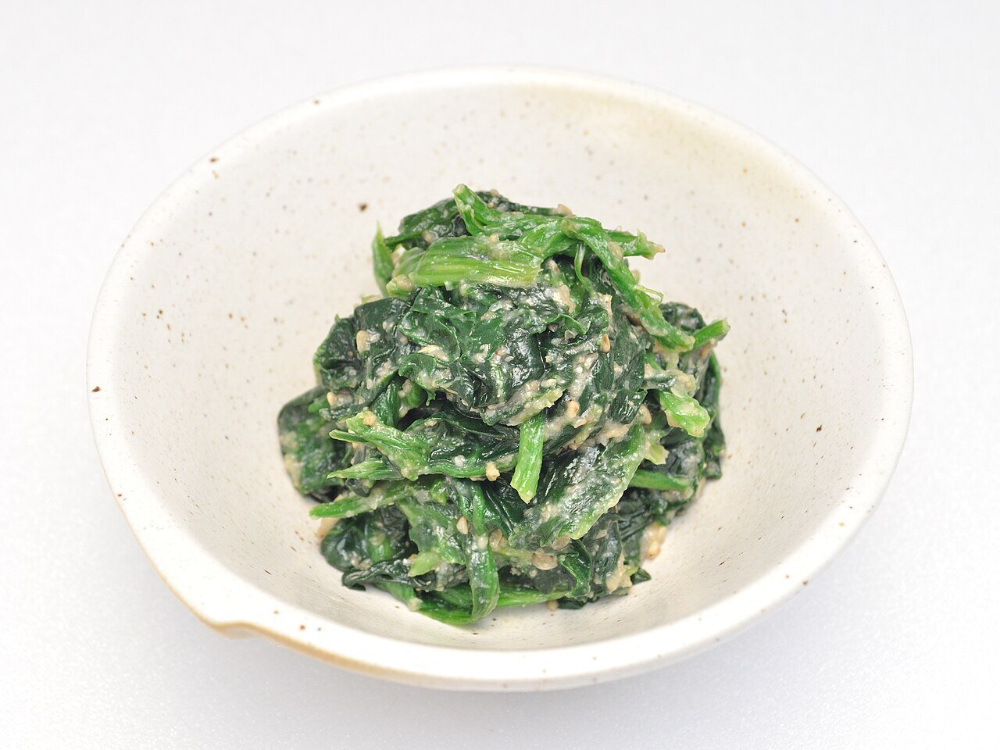

# Aliño goma-ae (sésamo para verduras)

*Foto: [Ocdp](https://commons.wikimedia.org/wiki/File:Spinach_Goma-ae_001.jpg), [CC0](https://creativecommons.org/publicdomain/zero/1.0/deed.es), vía Wikimedia Commons.*

Sésamo tostado y molido con salsa de soja y azúcar: el aliño japonés de las espinacas y las judías verdes goma-ae.

🥄 Para **4 personas** · ⏱️ 10 minutos · Dificultad: fácil

*In English:* [Japanese sesame dressing for greens](goma-ae.en.md)

## Ingredientes

- 4 cucharadas de sésamo blanco
- 1½ cucharadas de salsa de soja
- 1 cucharada de azúcar
- 1 cucharadita de mirin (opcional)
- 1 cucharadita de aceite de sésamo tostado (opcional)
- 300 g de espinacas (o judías verdes, o brócoli)

## Preparación

1. **Tostar.** Tuesta el sésamo en una sartén seca a fuego medio-bajo, moviéndolo, hasta que huela y se dore un poco. Que no se queme.
2. **Moler.** Muélelo en el mortero (suribachi) hasta que la mitad de las semillas estén rotas y empiece a soltar aceite.
3. **El aliño.** Añade el azúcar, la soja, el mirin y el aceite de sésamo y mezcla hasta tener una pasta húmeda.
4. **Las verduras.** Escalda las espinacas 30–60 segundos, enfríalas en agua con hielo, escúrrelas bien apretando y córtalas en trozos.
5. **Aliñar.** Mezcla las verduras con el aliño justo antes de servir.

## Consejos

- **Escurre bien** las espinacas: si quedan con agua, el aliño se diluye.
- **Sin alcohol:** quita el mirin y añade una pizca más de azúcar.
- **Con sésamo negro** se hace igual y queda más intenso.
