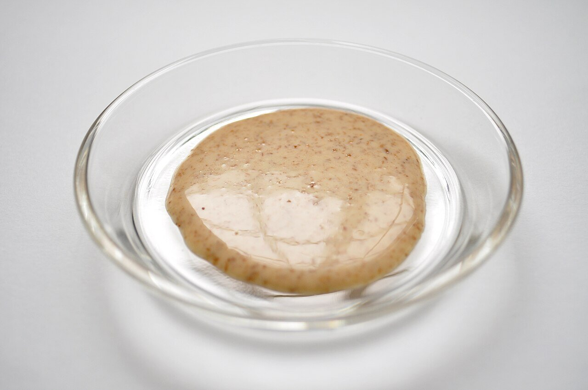

# Japanese sesame sauce

*Photo: [Ocdp](https://commons.wikimedia.org/wiki/File:Gomadare.jpg), [CC BY-SA 3.0](https://creativecommons.org/licenses/by-sa/3.0/), via Wikimedia Commons.*

Sesame paste, soy sauce, rice vinegar, sugar and sesame oil: the creamy sauce for shabu-shabu and cold noodles.

🥄 Serves **4** · ⏱️ 10 minutes · Difficulty: easy

*En español:* [Goma dare (salsa japonesa de sésamo)](goma-dare.es.md)

## Ingredients

- 3 tablespoons sesame paste (neri goma or tahini)
- 2 tablespoons soy sauce
- 1 tablespoon rice vinegar
- 1 tablespoon sugar
- 1 tablespoon mirin
- 1 teaspoon toasted sesame oil
- 3–4 tablespoons dashi or water
- 1 teaspoon toasted sesame seeds, to serve

## Directions

1. **Base.** In a bowl, stir the sesame paste with the sugar until smooth.
2. **Thin.** Stir in the soy sauce, vinegar and mirin. It thickens at first; keep stirring.
3. **Dashi.** Add the dashi gradually until the sauce flows off a spoon like a light cream.
4. **Finish.** Add the sesame oil and taste. Serve topped with toasted sesame.

## Tips

- **Serve with** shabu-shabu, cold soba or udon, chilled tofu, cucumber salad or poached chicken.
- **Alcohol-free:** skip the mirin and add ½ teaspoon more sugar.
- **Neri goma** (Japanese toasted sesame paste) has more flavor than tahini, which is made from raw sesame.
