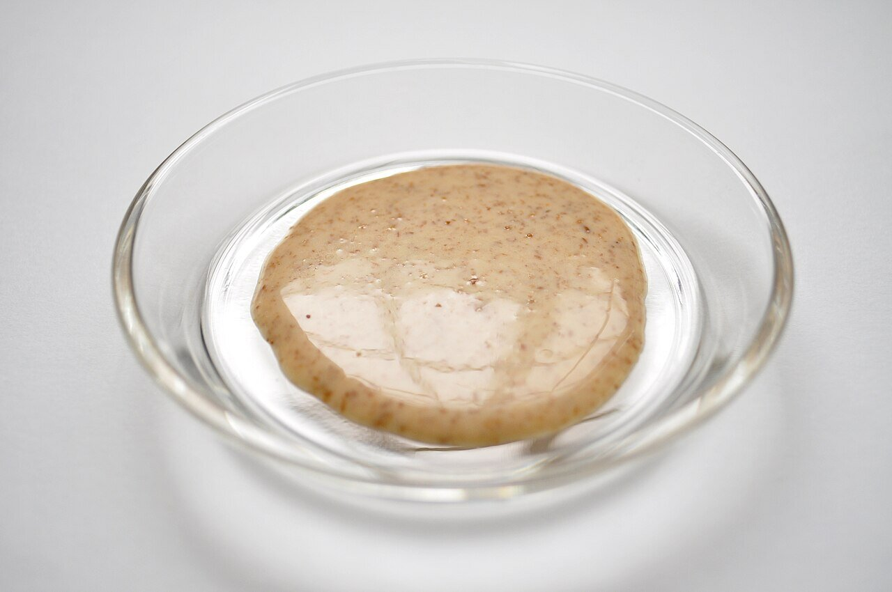

# Goma dare (salsa japonesa de sésamo)

*Foto: [Ocdp](https://commons.wikimedia.org/wiki/File:Gomadare.jpg), [CC BY-SA 3.0](https://creativecommons.org/licenses/by-sa/3.0/deed.es), vía Wikimedia Commons.*

Pasta de sésamo, salsa de soja, vinagre de arroz, azúcar y aceite de sésamo: la salsa cremosa del shabu-shabu y de los fideos fríos.

🥄 Para **4 personas** · ⏱️ 10 minutos · Dificultad: fácil

*In English:* [Japanese sesame sauce](goma-dare.en.md)

## Ingredientes

- 3 cucharadas de pasta de sésamo (neri goma o tahini)
- 2 cucharadas de salsa de soja
- 1 cucharada de vinagre de arroz
- 1 cucharada de azúcar
- 1 cucharada de mirin
- 1 cucharadita de aceite de sésamo tostado
- 3–4 cucharadas de dashi o de agua
- 1 cucharadita de sésamo tostado, para servir

## Preparación

1. **La base.** En un bol, mezcla la pasta de sésamo con el azúcar hasta que quede lisa.
2. **Aclarar.** Añade la soja, el vinagre y el mirin removiendo. Al principio espesa: sigue removiendo.
3. **El dashi.** Añade el dashi poco a poco hasta que la salsa caiga de la cuchara como una crema ligera.
4. **Terminar.** Añade el aceite de sésamo y prueba. Sirve con el sésamo tostado por encima.

## Consejos

- **Con** shabu-shabu, soba o udon fríos, tofu frío, ensalada de pepino o pollo cocido.
- **Sin alcohol:** quita el mirin y añade ½ cucharadita más de azúcar.
- **Neri goma** (pasta de sésamo tostado japonesa) da más sabor que el tahini, que es de sésamo crudo.
