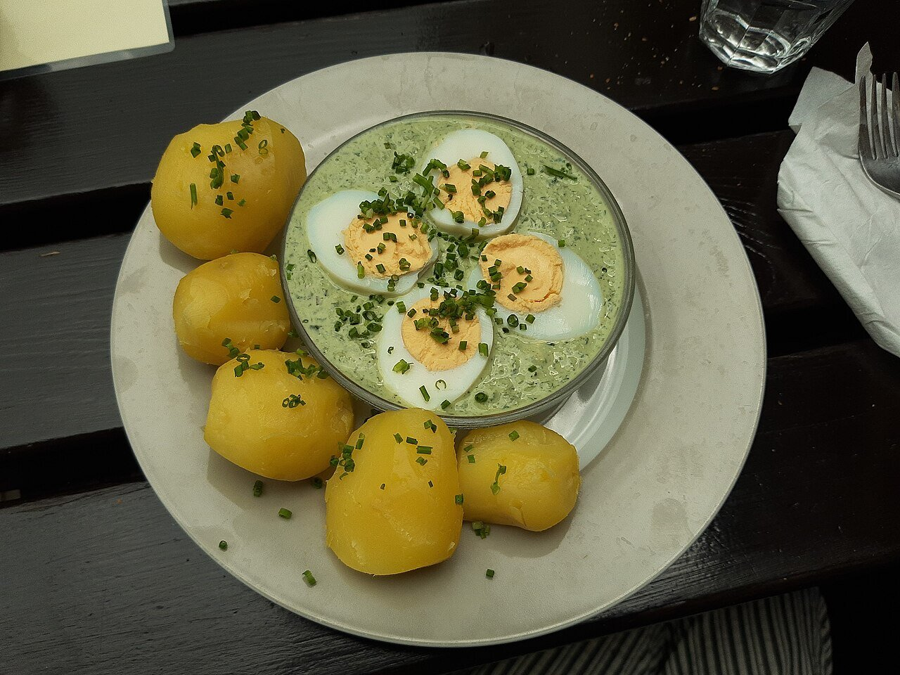

# Grüne Soße (salsa verde de Fráncfort)

*Foto: [Gerda Arendt](https://commons.wikimedia.org/wiki/File:Gr%C3%BCne_So%C3%9Fe,_R%C3%BCdesheim.jpg), [CC0](https://creativecommons.org/publicdomain/zero/1.0/deed.es), vía Wikimedia Commons.*

Siete hierbas frescas picadas con nata agria, yogur y huevo duro: la salsa fría de Fráncfort, que se sirve con huevos duros y patatas cocidas, como en la foto.

🥄 Para **4 personas** · ⏱️ 20 minutos + 1 hora de reposo · Dificultad: fácil

*In English:* [Frankfurt green sauce (Grüne Soße)](gruene-sosse.en.md)

## Ingredientes

- 200 g de hierbas frescas en total: perejil, cebollino, berros, acedera, borraja, perifollo y pimpinela
- 200 g de nata agria (o crème fraîche)
- 200 g de yogur natural
- 2 huevos duros (y 4-8 más para servir)
- 1 cucharada de aceite
- 1 cucharadita de mostaza
- 1 cucharadita de zumo de limón o vinagre
- Sal, pimienta y una pizca de azúcar

## Preparación

1. **Las hierbas.** Lávalas, sécalas bien y quita los tallos duros.
2. **Picar.** Pícalas muy finas con un cuchillo o pásalas por la picadora a golpes cortos, sin hacer puré.
3. **La base.** Machaca las yemas de los 2 huevos con el aceite y la mostaza, y añade la nata agria, el yogur y el limón.
4. **Mezclar.** Añade las hierbas y la clara picada, salpimienta y añade el azúcar.
5. **Reposar.** Déjala 1 hora en la nevera. Sírvela con huevos duros por la mitad y patatas cocidas.

## Consejos

- **Sin todas las hierbas:** si no encuentras borraja o pimpinela, aumenta el perejil, el cebollino y los berros, y añade algo de eneldo.
- **El jueves santo** es el día tradicional para comerla en Hesse.
- **Con carne:** también acompaña el tafelspitz y el schnitzel.
