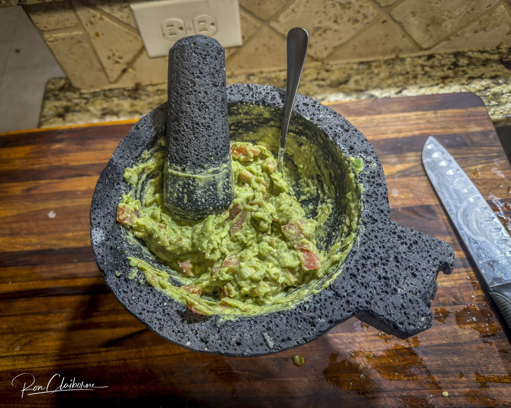

# Guacamole

*Photo: [Jazz Guy from College Station, Texas, United States](https://commons.wikimedia.org/wiki/File:Guacamole_tradicional.jpg), [CC BY 4.0](https://creativecommons.org/licenses/by/4.0/), via Wikimedia Commons.*

Avocado mashed in a molcajete with onion, tomato, cilantro and lime. The chile is optional and seeded, so it's barely spicy.

🥄 Serves **4** · ⏱️ 10 minutes · Difficulty: easy · Heat: mild

*En español:* [Guacamole](guacamole.es.md)

## Ingredients

- 3 ripe avocados
- ¼ white onion
- 1 ripe tomato
- 1 handful cilantro
- Juice of 1 lime
- ½ serrano or jalapeño chile, seeded (optional)
- Salt

## Directions

1. **Base.** In a molcajete (or a bowl), mash the chopped onion, the chile, if using, and half the cilantro with a pinch of salt into a paste.
2. **Avocado.** Add the avocado flesh and mash it with a fork or the pestle, leaving some chunks.
3. **The rest.** Add the seeded, finely diced tomato, the rest of the cilantro, chopped, and the lime juice.
4. **Taste.** Adjust salt and lime and serve right away.

## Tips

- **To keep it green:** press plastic wrap right onto the surface.
- **No heat at all:** skip the chile; it's still a great guacamole.
- **Serve with** tortilla chips, tacos, beans or grilled meat.
